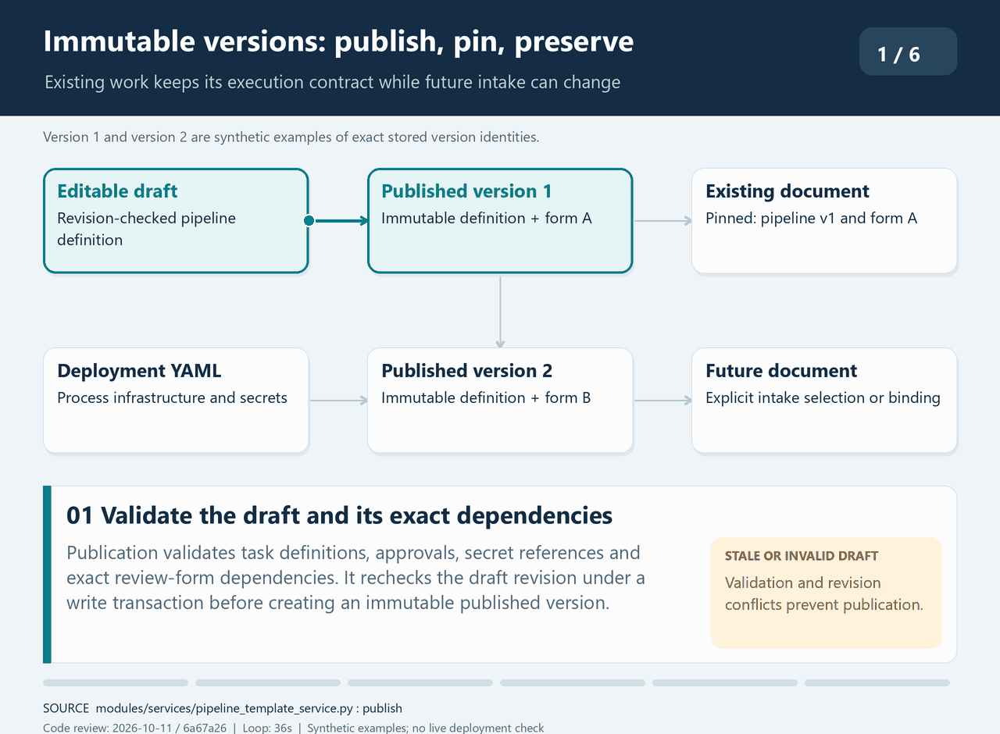

# Configuration ownership and immutable versions

| Item | Value |
| --- | --- |
| Audience | Software architects and technical leads |
| Owner | Application maintainers |
| Status | Current |
| Last verified | 2026-10-10 — repository/source review; no live deployment check |
| Applies to | Production application; SQLite schema 9 |

## Configuration architecture

Deployment YAML configures process infrastructure and secret aliases.
SQLite stores operational settings and immutable pipeline/review versions.
Each process has its own config snapshot, so YAML edits require restart.

Runtime YAML is resolved in this order:

1. `--config-path`
2. `CONFIG_PATH`
3. Repository-root `config.yaml`

| Concern | Current owner |
| --- | --- |
| Pipeline templates, drafts, immutable versions | SQLite versioned-configuration tables |
| Review-form templates, drafts, immutable versions | SQLite versioned-configuration tables |
| Exact pipeline-to-review-schema dependency | SQLite `pipeline_version_schema_dependencies` |
| Upload selection and watch-folder binding | SQLite assignment columns and `watch_folder_bindings` |
| Paths, web/auth options, database location, secret aliases | Deployment YAML/environment |
| Operational/admin settings | SQLite `app_settings` |
| Legacy root pipelines and filesystem schemas | Migration/import-only sources |

`ConfigManager` remains the deployment configuration provider for application
startup, paths, authentication/web options, the SQLite location, task
approval, and resolving secret aliases before execution. It is not the source
of workflow composition or task behavior for a versioned document. The watch
input directory is not auto-created.

Configuration instances are explicitly owned by each process; they are not
Python singletons. Each web app constructs its dependencies once at startup and
binds that dependency set to request contexts, including synchronous handlers.
`get()`, `get_all()`, and the compatibility `config` property return defensive
copies. Startup migration can validate and replace its own snapshot explicitly
after committing the cutover. Children load the resulting YAML after migration.
Snapshots are not synchronized across processes: deployment YAML edits require
a coordinated restart. Live operational settings remain authoritative in SQLite.

Configuration loading raises `ConfigurationError` rather than exiting Python.
Process entry points fail startup with safe diagnostics. The loader separates
directory preparation from validation; `prepare_directories=False` validates
existing paths without creating directories. The default startup behavior still
prepares configured `*_dir` paths after required upload/watch roots are checked.

Relative deployment paths resolve from the absolute YAML file directory, with
user-home and environment-variable expansion. Runtime database access, schema
loading, and config-check use shared resolution rules. Config-check defaults to
the checked YAML directory; `--base-dir` overrides only filesystem validation,
not the deployment-selected SQLite database. Validation of an in-memory mapping
without an explicit base or source file defaults to the current directory.

A minimal deployment configuration has this shape (the actual task composition
is normally stored in published SQLite versions):

```yaml
database:
  path: data/docflow.db
web:
  host: 127.0.0.1
  port: 8000
  upload_dir: web_upload
watch_folder:
  dir: watch_folder
  processing_dir: processing
logging:
  log_file: logs/docflow.log
  log_level: INFO
```

The configuration precedence and relative-path rules above apply to all
processes. Deployment YAML edits require a coordinated restart of parent, web,
and worker processes.
Publishing a pipeline or changing SQLite-backed operational settings does not
change already-pinned batches and generally does not require a process restart.

The parent sets these process-coordination variables for its children:
`DOCFLOW_PROCESS_ROLE`, `DOCFLOW_STARTUP_MODE`, `DOCFLOW_RUN_ID`,
`DOCFLOW_EXPECTED_COMPONENTS`, and `DOCFLOW_STDIO_CAPTURED`. `APP_ENV` (or
`ENV`/`ENVIRONMENT`) controls production security defaults, while `USE_RELOAD`
controls development reload behavior and is disabled in production.

The standalone checker validates deployment YAML and, when `database.path` is
configured, opens SQLite in read-only/query-only mode and validates the active
published configuration and bindings by default. Deployment YAML may omit
legacy root `pipeline` and `tasks` after migration. Valid `$secret` references
are checked as aliases while resolved values remain outside stored definitions:

```powershell
.\.venv\Scripts\python.exe -m tools.config_check validate `
  --config path\to\config.yaml --import-checks
```

Stored selectors include `--pipeline KEY` or `--review-schema KEY` with exactly
one of `--draft`/`--version N`; `--all-stored` audits every stored source.
`validate-file --kind runtime` and `--kind review-schema` check portable files
without importing them. The current `--kind pipeline` path expects an incompatible
`pipeline-bundle` wrapper and is not a supported validation route for bundles;
validate the imported stored draft in the app or through a stored selector. Warning-only results use exit code `2`;
usage errors use `64`. The checker does not migrate or modify SQLite.

Admin services support template lifecycle, optimistic draft revision checks,
validation, redacted diff/export, import into drafts, and immutable publication.
Create a separate form by creating a new template and importing a definition.
Existing batches/documents, split children, task runs, and review items remain pinned
to their recorded versions across later publication or lifecycle changes.
Provider secrets must never enter API responses, audits, summaries, logs,
screenshots, tests, commits, or documentation.

## Pipeline construction

The exact `pipeline_version_id` assigned before ingestion determines order and
task configuration. `PipelineDefinitionService` loads that immutable version,
verifies its content hash and approved module/class pairs, injects exact
published review-schema dependencies, and resolves configured secret aliases
in memory. A portable definition uses the familiar shape:

```yaml
tasks:
  example_task:
    module: standard_step.example
    class: ExampleTask
    params: {}
    on_error: stop

pipeline:
  - example_task
```

For each task, `WorkflowLoader` verifies module/class approval, places the
configured pipeline key and index in `current_task_key` and
`current_task_index`, starts a SQLite task run attributed to the pinned
`pipeline_version_id`, instantiates the task with the resolved immutable
parameters, invokes it through a Prefect task wrapper, and persists the result.
It never reloads the current global YAML pipeline or substitutes the newest
published version. Versioned tasks receive a restricted configuration provider
that exposes the SQLite database location for shared persistence but hides
deployment YAML workflow sections and secrets; task behavior comes only from
the resolved published parameters.
`on_error` is `stop` or `continue`. A continued failure is recorded in
`continued_failures` while the transient `error` fields are cleared for the
next task, so a successful downstream task receives its own completed task-run
state. The latest continued failure is restored before leaf finalization, so
the document still finishes as failed rather than hiding the earlier error.

Configured tasks and cleanup currently receive one Prefect retry. Individual
provider tasks can add their own retries, so retry policy is not centralized.
The processing queue retries transient workflow startup failures and input I/O
errors raised by the file processor, up to its configured attempt limit. A workflow returning failure
or an unclassified exception is terminal at the queue level; replaying a flow
that may already have performed durable work requires an explicit recovery
decision. Configured task retries remain separate from queue retries.
After configured execution exhausts the pipeline or stops on an ordinary
failure, cleanup runs as an internally managed task with the reserved key
`cleanup_task` and index immediately after the configured pipeline. It has its
own SQLite task run but does not move the document's configured pipeline
cursor. Review pause and split fan-out return before cleanup; resumed and split
child flows run cleanup when their configured work finishes.

### Animated immutable version pinning



This 36-second loop uses synthetic version numbers to follow publication,
explicit intake assignment and later execution. Existing documents keep their
exact pipeline and form versions. Deployment YAML snapshots and in-memory secret
resolution remain separate concerns. Source-verified on 2026-10-11 at commit
`6a67a26`; no live deployment check.

## Watch-folder administration

A binding selects an exact eligible pipeline version for future
claims. Its lifecycle controls whether claims can occur; it does not delete
source directories or PDFs. The coordinator serializes claims against binding
changes.

`/app/admin/watch-folders` independently manages binding configuration. A binding
is enabled, paused (assignment retained), unbound (assignment cleared), or retired
(disabled and immutable). Paused/unbound paths remain reserved. Retired paths
are reusable through a new binding identity; historical batch references remain
intact. Only unreferenced settings may be permanently deleted. No lifecycle
action deletes source directories or PDFs.

Detailed lifecycle operations, revision semantics, health freshness, and admin
page behavior are in the [watch-folder administration reference](../admin/managing-watch-folders.md).
The architecture invariant is that each claim re-reads its binding while serialized against
administrative changes; an in-flight claim may finish, and later claims use the
current assignment.

## Binding lifecycle

`/app/admin/watch-folders` manages binding configuration. A binding is enabled,
paused (assignment retained), unbound (assignment cleared), or retired (disabled
and immutable). Paused and unbound paths remain reserved. Retired paths are
reusable through a new binding identity; historical batch references remain
intact. Only unreferenced settings may be permanently deleted. Lifecycle
actions do not delete source directories or PDFs.

## Health and access checks

`watch_folder_health` stores scan, success, and ingestion timestamps, scan
issues, and ignored-file counts. The UI distinguishes configuration state from
scan health; missing or old observations are stale after the larger of 30
seconds or three poll intervals. Test access/Check run non-ingesting directory
existence/listing checks in the web process. They do not test destructive
filesystem permissions, enqueue work, start a watcher, or replace coordinator
scan timestamps.

The page presents exact-version upgrades, lifecycle confirmations, filters,
bounded activity history, and binding-scoped Reports links. Audit Log includes
the existing `admin_` event family and `watch_binding.*` configuration events.
