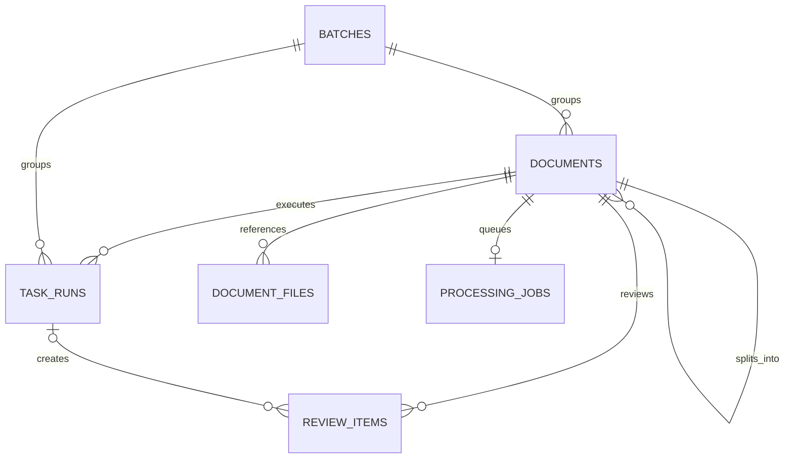

# Persistence and artifact ownership

| Item | Value |
| --- | --- |
| Audience | Software architects and technical leads |
| Owner | Application maintainers |
| Status | Current |
| Last verified | 2026-10-10 — repository/source review; no live deployment check |
| Applies to | Production application; SQLite schema 9 |

## Persistence and artifacts

SQLite stores operational records and artifact references; the local
filesystem stores PDF and export contents. Repositories own table operations,
and services coordinate cross-table invariants.

| Domain | SQLite tables |
| --- | --- |
| Identity | `users` |
| Processing | `batches`, `documents`, `task_runs` |
| Extraction | `extraction_results`, `extracted_fields` |
| Review | `review_items`, `review_locks` |
| Artifacts | `document_files` |
| Governance | `audit_events`, `app_settings`, `config_versions`, `pipeline_cleanup_previews` |
| Versioned pipelines | `pipeline_templates`, `pipeline_drafts`, `pipeline_versions`, `pipeline_version_schema_dependencies` |
| Versioned review forms | `review_schema_templates`, `review_schema_drafts`, `review_schema_versions` |
| Ingress configuration | `watch_folder_bindings` |
| Runtime health | `runtime_component_health`, `watch_folder_health` |
| Schema management | `schema_migrations` |

The main execution relationship is `batches → documents → task_runs`; a review
gate adds `review_items`, artifacts are recorded in `document_files`, and
ingestion queues each document in `processing_jobs`. Split documents point to
their parent through `documents.parent_document_id`.

[`modules/db/connection.py`](../../modules/db/connection.py) resolves the database
relative to the active configuration, enables row access and foreign keys,
and provides transaction helpers. Repositories own table-specific operations;
services coordinate cross-table behavior.
Use `managed_connect(config)` for a scoped transaction so the connection is
closed after commit or rollback. Use `connect(config)` only when a service owns
the connection beyond one block, and close it explicitly when finished.

Migrations currently apply an idempotent schema and record a coarse version.
This is not a complete ordered migration chain with per-change upgrade and
downgrade scripts. During normal startup, only the parent runs migrations; its
web and worker children verify the exact schema without modifying it. Request
handling does not run schema migrations. Standalone web or worker processes
must explicitly select migration mode when they own database initialization.

Schema 9 separates audit identities from processing retention. The upgrade
rebuilds `audit_events` without processing-record foreign keys, preserving every
event, historical entity ID, payload, timestamp, and rowid. Historical audit IDs
may point to removed operational records. Pipeline/version identities and their
immutability triggers remain intact.

`PipelineCleanupService` coordinates independent archive and whole-batch cleanup
actions; `ProcessingHistoryRepository` owns table queries and dependency-ordered
deletion. Archive requires an inactive template and no enabled ingress bindings,
and retains existing pinned execution. Cleanup checks terminal documents/children,
jobs, task runs, reviews, locks, split decisions, and latest activity against an
exclusive UTC cutoff. It excludes mixed assignments and cross-batch children.
An actor-bound 15-minute preview stores a SHA-256 digest of the selected records;
confirmation recomputes it under `BEGIN IMMEDIATE` before deleting anything.
All deletions, receipt trimming, preview consumption, and the admin audit event
commit together. A retained foreign-key reference aborts and rolls back cleanup.
The connection-local temporary selection avoids SQL parameter-count limits.

Cleanup removes artifact registrations but never their physical files. Audit
events and version definitions remain. Upload receipt response payloads become
minimal tombstones while user/key/fingerprint identities remain to prevent old
submission retries from recreating purged work. Receipt lookup returns `purged`;
the browser clears its stale receipt and waits for an explicit new upload.
Freed SQLite pages can be reused; neither VACUUM nor physical-file cleanup is
part of this workflow.

The operator consequences, API payloads, compaction limits, and schema-9 upgrade
requirements are maintained in the
[pipeline retention reference](../admin/archiving-and-retention.md).

`modules/services/startup_migration_service.initialize_database()` coordinates
structural upgrades, legacy configuration import, YAML compensation on failure,
and refresh of the migration owner's configuration snapshot. Structural upgrades
in `modules/db/migrations.py` do not import application services. Supported schema
markers live in `modules/db/schema_version.py`; read-only checks can import these
without loading the legacy importer. The legacy importer uses the public
`SchemaService.resolve_schema_path()` API, which enforces configured schema roots.

SQLite stores artifact identity, role, path, and metadata. The filesystem
stores contents. Canonical roles are:

| Role | Meaning |
| --- | --- |
| `source_original` | Original ingested PDF |
| `split_pdf` | Split child PDF |
| `source_archive` | Archived source copy |
| `export_pdf` | Final PDF output |
| `export_csv` | CSV metadata export |
| `export_json` | JSON metadata export |

Task-created artifact metadata records `task_key` from the workflow context
when producer attribution is needed. Artifact role remains represented by
`file_type`; a separate task slug is not part of the task contract. Ingestion
artifacts such as `source_original` have no producer task key. Split children
and their `split_pdf` artifacts record the configured split task key.

Generated archive, export, and split paths are reserved with exclusive file
creation before content is written. This prevents overlapping local workflows
from selecting and overwriting the same nominally unique output path.

Runtime directories such as `data/`, `files/`, `processing*/`,
`archive_folder/`, `web_upload/`, and `watch_folder/` may contain customer
data and are not source code. Durable task outputs should use
`register_document_artifact`; registered artifacts must survive cleanup.
Registration is currently best-effort, so an unregistered successful file
operation remains a traceability risk. Database exceptions during registration
produce a warning containing only the document identifier, artifact role, and
exception type; the primary file-operation result remains unchanged.

SQLite and local filesystem coupling suit a local or modest-volume
installation. They do not provide a horizontally scaled worker architecture.

## Persistence and revisions

Schema version 7 rebuilds binding constraints to allow nullable assignments and
adds retirement timestamps and optimistic revisions. The migration preserves
binding IDs and checks foreign keys before committing. Configuration changes
advance revisions; monitoring observations do not. Pause, unbind, and retire do
not require a healthy filesystem or executable assignment.

Before each file claim, the coordinator re-reads the binding under SQLite's
write lock, verifies the source directory and exact-version eligibility, and
serializes the claim against administrative mutations. A started claim may
finish before an update; subsequent claims use the current configuration. New
batch metadata retains the source folder and binding revision. Earlier records
are not backfilled with guessed source snapshots.
