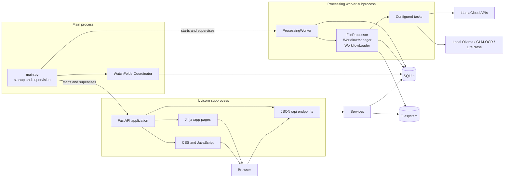
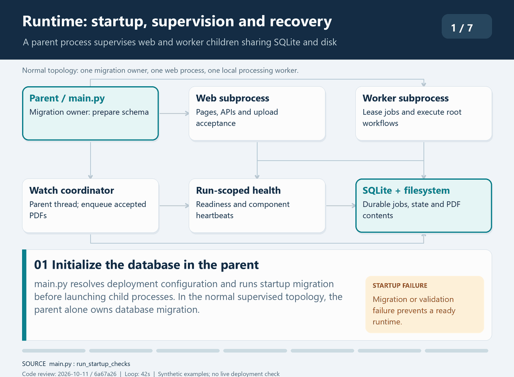

# Runtime topology and component boundaries

| Item | Value |
| --- | --- |
| Audience | Software architects and technical leads |
| Owner | Application maintainers |
| Status | Current |
| Last verified | 2026-10-10 — repository/source review; no live deployment check |
| Applies to | Production application; SQLite schema 9 |

## Runtime topology

The parent migrates the database, supervises child processes, and
polls watch-folder bindings. The web process handles browser/API requests; the
worker subprocess alone runs queued root workflows. All processes share SQLite
and configured filesystem paths.

The default deployment contains a parent process plus two child processes:

1. `main.py` resolves configuration, configures supervisor logging, runs
   migrations, validates the task registry, and constructs ingestion/workflow
   components.
2. Unless `--no-web` is supplied, it starts Uvicorn as a subprocess.
3. It starts a dedicated durable processing-worker subprocess.
4. The parent process runs the polling watch-folder coordinator in a thread and
   supervises both child processes.
5. The parent, web, and worker processes access the configured SQLite database and
   filesystem; only the worker executes queued root workflows.

The parent is the sole migration owner in this topology. Before either child
accepts work, the web and worker processes use read-only startup verification
to require the exact supported schema version and essential runtime tables.
Startup validation failures propagate out of application construction; the web
process does not continue serving a partially initialized application.

Each launch has a fresh run ID. The supervisor, web process, worker, and
watch-folder coordinator write run-scoped heartbeats to SQLite and must all
report ready within a bounded startup window. Worker heartbeats continue on a
dedicated thread while OCR is running; inaccessible watch-folder bindings mark
ingestion degraded without marking the worker unavailable. Unexpected
component exits make the supervisor stop the remaining process trees and exit
nonzero. On Windows, children run in separate process groups so shutdown first
requests an orderly stop after current worker activity, then force-terminates
the full process tree only if the bounded grace period expires.

`logging.log_file` is a deployment-configured base path. Normal startup derives
separate `.supervisor`, `.web`, and `.worker` files from it, resolves a
relative path beside the active configuration file, and applies
`logging.log_level` to each process. Log records include the process role and
PID. The parent redirects Uvicorn stdout and stderr to the web-role log so
output emitted before web logging initializes is retained.

Watch-folder files and web batch uploads are persisted as SQLite processing jobs
before the producer acknowledges them. A worker claims one job with a lease and
executes it; expired leases are requeued after a worker interruption. Split
children are still launched sequentially inside the claimed workflow. There is
one local worker, not a distributed queue, worker pool, or multi-host
coordination layer.

Extraction providers are independent implementations behind the same workflow
boundary: tasks normalize results into the shared top-level `context["data"]`
contract and persist provider-neutral results. Provider-specific configuration,
chunking, retries, and supported field shapes belong with provider task
documentation and implementation, not this architecture boundary reference; see
the [GLM-OCR task design](../../tasks/design-and-implementation-glm-ocr-extract-task.md)
and [LiteParse task guide](../reference/tasks/liteparse-extraction.md).

LiteParse/Ollama persists typed values and diagnostic parser-derived sources
through the same extraction repositories and review services. Null confidence
is preserved; the task requests review through a structured flag and the gate
owns the pause. Diagnostic citations retain page evidence but are not promoted
to verified PDF highlights. Review completion persists final values, and the
pinned downstream storage step registers its export without rerunning
extraction. See the [visual validation report](../history/validation/liteparse-pipeline-2026-10-04.md)
for the six-invoice run and runtime limitations.

### Animated runtime startup and recovery

This 42-second loop shows parent-owned migration, child schema verification,
readiness, durable acceptance and failure shutdown. Expired leases can be
requeued by a worker after a later runtime launch; the supervisor does not hot
restart an exited worker. Source-verified on 2026-10-11 at commit `6a67a26`;
no live deployment check.

## Component boundaries

| Component | Responsibility | Boundary |
| --- | --- | --- |
| [`main.py`](../../main.py) | Startup, supervision, shutdown | No workflow business logic |
| [`WatchFolderCoordinator`](../../modules/services/watch_folder_coordinator.py) | Reconcile enabled bindings, validate and claim PDFs, and enqueue assigned jobs | Does not execute workflows |
| [`ProcessingWorker`](../../modules/services/processing_worker.py) | Lease queued jobs and trigger the assigned workflow | No ingestion or task policy |
| [`FileProcessor`](../../modules/file_processor.py) | Validate the assigned SQLite context and trigger processing for a worker job | No task policy |
| [`WorkflowManager`](../../modules/workflow_manager.py) | Start root, child, and resumed flows | No table-specific persistence |
| [`WorkflowLoader`](../../modules/workflow_loader.py) | Approve, instantiate, and execute configured tasks | No domain task behavior |
| [`BaseTask`](../../modules/base_task.py), `standard_step/` | One configured operation | Preserve context and failure contracts |
| [`modules/services/`](../../modules/services) | Use cases and cross-table invariants | No HTTP request concerns |
| [`modules/db/repositories.py`](../../modules/db/repositories.py) | Table-specific persistence | No cross-domain orchestration |
| [`modules/api_router.py`](../../modules/api_router.py) | JSON API composition | New business logic belongs in services |
| [`web/server.py`](../../web/server.py) | App construction and authenticated page routes | No workflow-state ownership |
| [`web/templates/`](../../web/templates) | Server-rendered structure | No authorization enforcement |
| [`web/static/js/`](../../web/static/js) | Browser interaction and API consumption | No authoritative business state |

### Frontend module boundaries

The production UI remains a server-rendered, multi-page application using
native browser JavaScript. The large page-controller migration is complete for
the production operator and administrative pages; the remaining top-level
controllers are compatibility/orchestration entry points. Feature directories
contain a thin entry point, a transport adapter, browser-independent model
operations, preview/formatting logic, and DOM views. The page controller
coordinates those pieces and continues to rely on the backend APIs as the
authoritative state boundary.

Feature-specific property editors receive selected model state and findings
through explicit contracts, while file and directory browsing is isolated
behind injected API and rendering callbacks. This keeps task-family HTML and
resource-loading behavior out of page-level event orchestration.

Native module entry points and every import in their dependency graph must carry
the same release asset version until content-hashed assets replace query-based
versioning. This prevents a newly deployed entry point from executing with a
cached model or view from an earlier release.

`modules/api_router.py` remains a large integration point. The intended
route/service/repository boundary is therefore both a design rule and current
technical debt.
