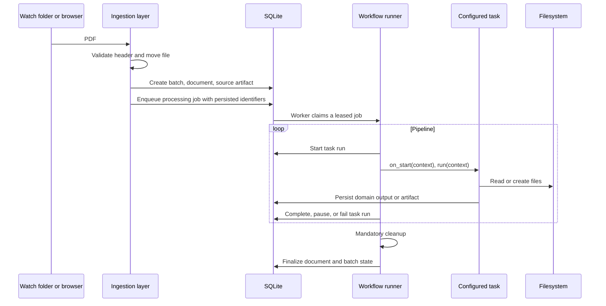
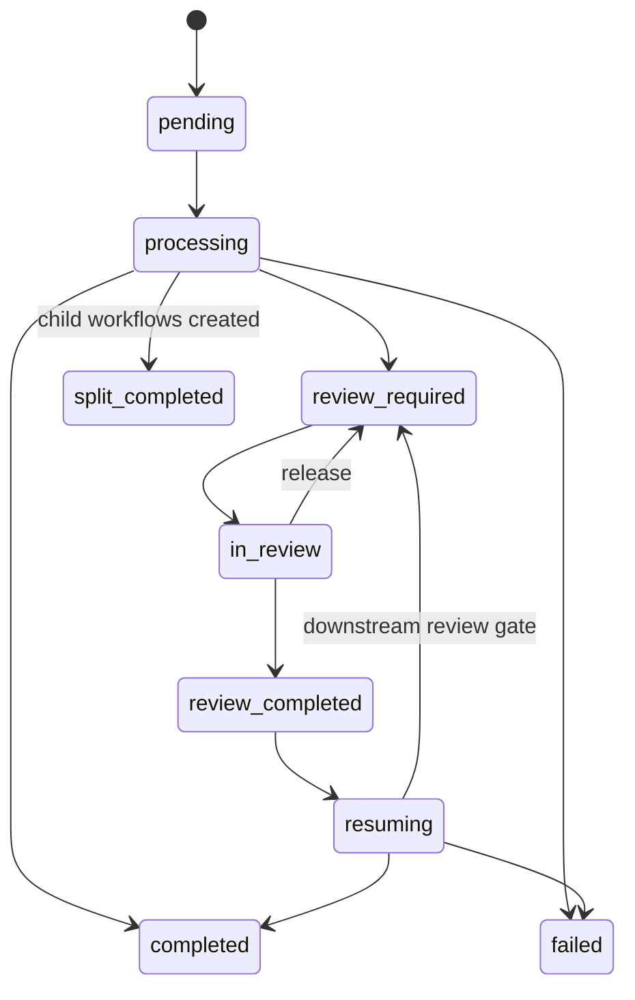
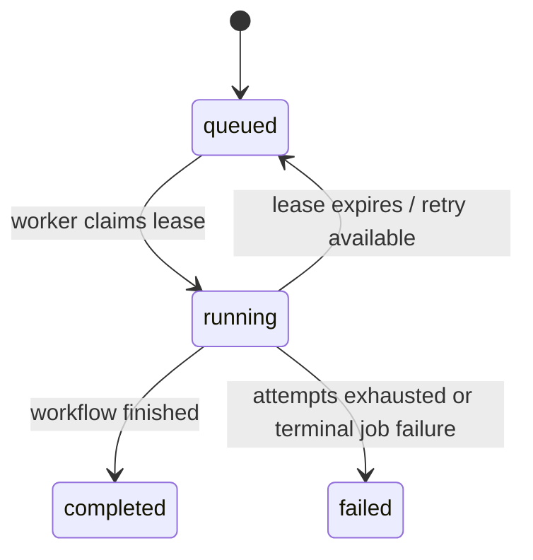
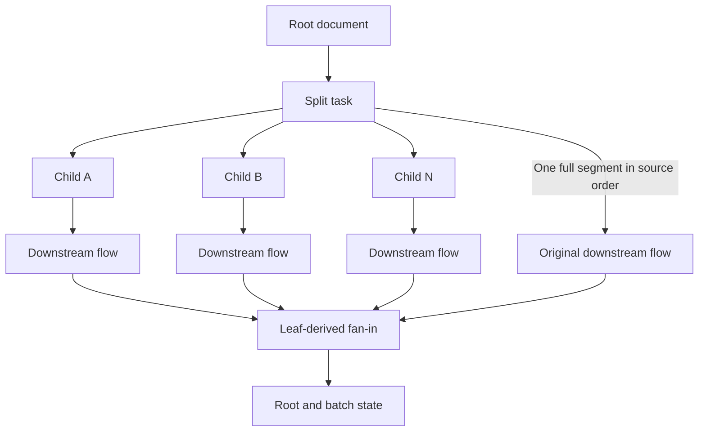

# Workflow execution and state

| Item | Value |
| --- | --- |
| Audience | Software architects and technical leads |
| Owner | Application maintainers |
| Status | Current |
| Last verified | 2026-10-10 — repository/source review; no live deployment check |
| Applies to | Production application; SQLite schema 9 |

## Ingestion and workflow execution

Ingestion validates a PDF, pins it to an immutable pipeline version,
creates batch/document/artifact records, then enqueues a durable job. A leased
worker executes tasks and writes state to SQLite; filesystem artifacts are
registered separately.

### Ingestion paths

- **Watch folder:** the serialized coordinator reconciles enabled bindings,
  claims a file only after resolving the binding's exact eligible version,
  validates the `%PDF-` signature, assigns a UUID, moves the file, and creates
  assignment-bearing batch/document rows plus a durable processing job
  atomically. Binding changes affect later claims only. Workflow execution is
  performed by the worker, not by the coordinator.
- **Primary web upload:** `POST /api/batches/upload` creates one batch with a
  document per accepted PDF only after the operator supplies one eligible
  published `pipeline_version_id`. The whole batch shares that exact version;
  invalid or stale selections create no rows or orphan files. Each accepted
  document receives its durable processing job in the same transaction. The
  multipart receiver streams file parts to disk and enforces request and
  concurrency limits without buffering the full body. It requires a complete
  multipart boundary before creating work, reconciles upload-owned orphan files
  after interrupted submissions, and serializes submissions/reconciliation
  with OS locks. Cancellation cleans staging files. Exact parser limits,
  deadlines, lock-file names, and receipt semantics are implementation details
  owned by `upload_receiver.py` and `upload_submission_service.py`.
  Browser submissions carry a UUID `Idempotency-Key`; SQLite `upload_submissions`
  receipts commit atomically with the batch and jobs. Repeating the same key,
  user, pipeline, and file contents returns the original batch; changed content
  is rejected. API clients omitting the key retain non-idempotent behavior.
  `GET /api/upload-submissions/{id}` returns an owner-scoped accepted receipt or
  `unknown`, which must never be interpreted as confirmed cancellation.
- **Legacy web upload:** `POST /upload` is retired and returns `410 Gone`.
  Legacy read-only response shapes remain for compatibility.

## State model

SQLite stores job, document, task-run, review, and aggregate states.
Review is a persisted pause followed by a new downstream flow. Split roots and
batches aggregate outcomes from leaf documents.

- A **batch** groups documents from one ingestion.
- A **document** represents a root PDF or split child.
- A **task run** records one configured task execution for one document.
- A **review item** represents operator work created by the review gate.

Task runs use `running`, `completed`, `paused`, and `failed`. Context values
such as `pipeline_state: paused` and `pipeline_state: fan_out` are execution
signals, not database entities.

Processing jobs have a separate lifecycle and are not document states:

Root and batch status is an aggregate of leaf document outcomes:

```mermaid
stateDiagram-v2
    [*] --> processing
    processing --> review_required: at least one leaf paused for review
    processing --> completed: all leaves succeeded
    processing --> completed_with_errors: mixed success and failure
    processing --> failed: all leaves failed
    review_required --> completed: review resolved; all leaves succeeded
    review_required --> completed_with_errors: mixed terminal outcomes
    review_required --> failed: all leaves failed
```

State transition ownership is split as follows:

| Transition or state | Owner |
| --- | --- |
| Job `queued`/`running`/lease expiry | `ProcessingJobService` and worker |
| Document task progress and terminal state | `WorkflowStateService` |
| `processing` → `review_required` | `ReviewGateTask` |
| `review_required` → `in_review` | `ReviewService` claim transaction |
| Review edits, release, and completion | `ReviewService` |
| `review_completed` → `resuming` | `ResumeManager` acquisition transaction |
| Resumed downstream execution | `WorkflowManager` and `WorkflowLoader` |
| Root/batch aggregate state | `FanInService` |

Do not infer workflow state from a status file, Prefect state, or a UI label.
Those may be compatibility or presentation surfaces; SQLite state and the
service transitions above are authoritative.

For split processing:

- A root may become `split_completed` after child creation.
- A root or batch remains `processing` while a leaf is non-terminal.
- A review leaf produces aggregate `review_required`.
- Mixed successful and failed leaves produce `completed_with_errors`.
- All failed leaves produce `failed`.

## Human review

Reviews are typed as `extraction` or `manual_split`. Manual decisions and
draft revisions live in `manual_split_decisions`, independently of extracted
fields and review schemas. Source identity and task/version attribution are
checked before approval and application. Manual approval resumes at the same
task to apply the accepted decision, then uses the shared split materializer
and existing fan-out/fan-in. Skips continue the original document without
children. See [manual split task](../reference/tasks/splitting.md) for the API, operator
flow, and explicit recovery limits.

Manual recovery preserves the original continuation claim until the attempt
finishes or an operator repairs it. Child workflow loading happens before
the atomic child claim, and retry dispatch carries the parent document and
batch identity for preflight failure attribution. Successful internal cleanup
does not block retrying an unapplied split decision; started downstream work
or failed cleanup does. Recovered manual failures remain in task history but
are excluded from errors inherited by successful continuations.

Manual split completion commits the immutable decision and returns HTTP 202
before running the resumed flow as a server background task. Child extraction
latency therefore does not hold the approval response open. The manual form
acknowledges the save immediately and refreshes application state separately;
the processing dashboard remains the source for downstream progress. This
dispatch mechanism is in-process and retains the documented recovery limits.

Human review is a persisted stop and new-flow restart:

1. Extraction persists normalized results and fields.
2. `ReviewGateTask` evaluates confidence, required-field, split-confidence,
   structured review flags, and configured policy.
3. If required, it creates a review item, marks the document
   `review_required`, and sets `pipeline_state` to `paused`.
4. The loader marks the task run paused and returns before downstream execution
   or cleanup. Cleanup runs after the resumed flow finishes configured work.
5. An operator claims the item, creating a time-limited lock and changing the
   document to `in_review`.
6. Draft corrections, diffs, and completion are handled by `ReviewService`.
7. Completion persists final values, completes the paused task run, and marks
   the document `review_completed`.
8. `ResumeManager` reconstructs context from SQLite, prevents duplicate
   downstream work, and starts a new flow at the next task.

While the synchronous completion request is in flight, the review page keeps
the operator informed with a live status message and changes the action to
`Saving review…`. Review actions are disabled for that interval so a slow
resume cannot be mistaken for an unresponsive page or trigger duplicate
submissions. A failed request restores the controls and reports the error.

Only pending or in-review items may be claimed or released. Resume acquisition
uses an atomic `review_completed` to `resuming` transition, so overlapping
requests cannot start the same downstream work twice. When the review gate is
the final configured step, resume still starts the terminal runner path so
cleanup and leaf-derived fan-in complete normally.

The original Prefect flow is not suspended. SQLite retains the business state
needed for operator work and resume.

Extraction tasks may preserve numeric provider confidence when it exists or
persist it as null when it does not. They must never fabricate a score.
Provider-neutral structured review flags contain a stable reason plus configured
top-level field keys; they must not contain prompts, provider responses,
credentials, or extracted customer values. A flag does not pause a workflow by
itself. A downstream review gate consumes it, marks the specified fields for
review, creates durable review state, and pauses. Without a review gate, the
same extraction output can continue directly to storage or another task.

Review lock acquisition is enforced atomically in SQLite. The current operator
may renew a lock, an expired lock may be claimed by another operator, and an
active lock cannot be overwritten by a competing claim.

## Split fan-out and fan-in

When one validated segment contains every source page exactly once in original
order, the split task keeps the original document ID, file path, and pinned
pipeline version. It persists category, confidence, pages, and the
`single_document` outcome without setting `fan_out` or `split_completed`.
Downstream tasks, review, cleanup, and leaf finalization run on the original.

`split_result_service` coordinates classification, metadata, and a redacted
`split_not_needed` audit event in one transaction. Saved decisions are scoped
to the configured task key, pipeline version, and source PDF SHA-256; retries
reuse a matching decision after rechecking policy. Review resume restores the
classification from SQLite. Empty results and disabled splitting retain their
existing continuation behavior without implying a classified single document.

For multiple segments, or one partial/reordered segment, the split task creates
child PDFs and document rows, records parent/root
relationships and split metadata, registers `split_pdf` artifacts, and sets
`pipeline_state` to `fan_out`. `WorkflowManager` starts each child after the
split step. It can run extraction preflight validation and record one
source-level failure affecting all children.

Child creation compensates files and queued child rows if a later segment
fails. If compensation cannot remove a partial child, the remaining partial
records are marked failed so the source and batch do not remain non-terminal.

`FanInService` calculates root and batch status from leaf documents. Parent
containers are not double-counted. Paused children keep the aggregate in
review; mixed terminal outcomes produce `completed_with_errors`.

The split-results API preserves child-count meanings and adds
`documents_continuing`, `split_outcome`, original classification, and an
`extraction_document_id`. The production page links a single-document outcome
to the original extraction and displays its downstream status separately from
the split decision. Existing historical children remain unchanged.

## Errors, recovery, and observability

Expected task failures use `TaskError`; unexpected exceptions become failed
context and task-run state. `on_error` controls stop/continue behavior. Fatal
failure summaries are redacted before persistence or API exposure.

Runtime approval, import, class lookup, and `BaseTask` inheritance failures use
`TaskSetupError`. They always stop and fail only the affected document, then
continue through cleanup and fan-in; they do not invoke process shutdown or
terminate the web server. Invalid configured implementations should still be
caught by startup/config import validation before work is accepted.

Current operational evidence consists of logs, task-run timelines, batch and
document state, failure records, review/audit events, and artifact records.
Supported metrics and distributed tracing are not currently emitted.

Recovery paths include the following:

- Completed review resumes from the next task using final persisted values.
- Resume reloads the document's pinned pipeline version and the review item's
  exact stored schema version; inactive or archived templates remain available
  for already-assigned work.
- Corrected provider/task failures are normally re-ingested.
- Fan-in is recomputed as child leaves finish.
- A claimed job whose lease expires is returned to the queue by the next worker
  poll. A workflow that fails after task execution begins still requires task
  idempotency or operator re-ingestion; the queue does not make external
  provider calls transactional.

## Manual split review exception

Manual split uses `review_kind=manual_split` and a revisioned immutable decision.
Its continuation re-enters the pinned split task to apply that decision; it
does not use extraction review's next-task-only resume. Approval commits before
background dispatch and HTTP 202 does not prove downstream completion. See the
[split continuation contract](../reference/tasks/splitting.md) for retry limits
and crash ambiguity. Keep accepted decision state separate from dispatch phase.
