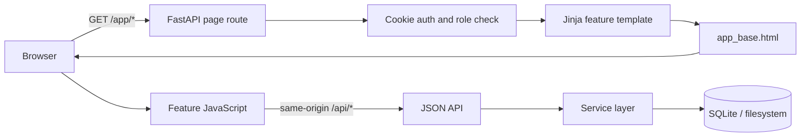

# Maintain the production frontend

| Item | Value |
| --- | --- |
| Audience | Developers and maintainers |
| Owner | Application maintainers |
| Status | Current |
| Last verified | 2026-10-10 — repository/source review; no live deployment check |
| Applies to | Production application; SQLite schema 9 |

## Frontend and UI architecture

Production pages are server-rendered with Jinja and page-specific
JavaScript modules. Browser code calls same-origin APIs; SQLite and services
remain authoritative, while authenticated routes protect pages and PDF previews.

For login, session cookies, CSRF, role checks, and PDF access boundaries, see the
[animated browser security flow](../architecture/security-and-trust.md#animated-browser-security-flow).

### Rendering and data flow



The production frontend is a server-rendered multi-page application.
[`web/server.py`](../../web/server.py) authenticates `/app/*` requests, enforces
admin access, and renders Jinja templates with small identifiers such as a
batch, document, review item, or schema name. Page scripts then fetch most
business data from `/api/*`.

Navigation performs full-page transitions. There is no production client
router, component framework, or central client store. Processing pages poll
for state changes; the processing overview currently refreshes about every
three seconds.

### Frontend layers

| Layer | Location | Responsibility |
| --- | --- | --- |
| Page routes | [`web/server.py`](../../web/server.py) | Authentication, roles, template, render context |
| Shared shell | [`app_base.html`](../../web/templates/app_base.html) | Navigation, header, slots, shared script |
| Feature templates | [`web/templates/`](../../web/templates) | Semantic structure and server identifiers |
| Shared browser utilities | [`app.js`](../../web/static/js/app.js) | API wrappers, CSRF, auth redirect, toasts, navigation |
| Feature entries and controllers | [`web/static/js/*/index.js`](../../web/static/js) and feature-local `controller.js` | Module startup, event-to-action orchestration, page-scoped transient state |
| Feature API/model/view modules | [`web/static/js/*/api.js`](../../web/static/js), `model.js`, `view.js` | Endpoint contracts, browser-independent state operations, DOM rendering and presentation |
| Vendored PDF.js | [`web/static/vendor/pdfjs/`](../../web/static/vendor/pdfjs) | Same-origin PDF rendering for source inspection |
| Styling | Tailwind, DaisyUI, [`app.css`](../../web/static/css/app.css) | Design utilities and application styles |

Templates and controllers form implicit DOM/API contracts and must change
together. Authoritative state remains on the server. `localStorage` holds
presentation preferences and short-lived caches; `sessionStorage` holds
limited navigation convenience; neither may represent workflow or permission
state.

The versioned review-form editor uses a native ES-module entry in
`web/static/js/schema-editor/`. Its controller maps browser events to actions;
the model owns DOM-independent nested-field changes and client validation;
the API owns review-schema requests and CSRF-aware imports; and the view owns
field rendering, outline/search, focus restoration, validation, and lifecycle
metadata. The editor entry and its imports use one release asset version so a
deployment cannot combine cached modules from different releases.

Operator pages cover upload, processing, split and extraction inspection,
review, failures, and reports. Admin pages cover the overview with editable
non-secret operational settings, fixed user accounts, watch folders, versioned
pipelines and review forms, the task catalog, legacy schema validation, and the
filtered administrative audit log.

Extraction and human-review pages use local PDF.js modules to render source PDFs
and may navigate to provider-supplied evidence. Source files are served through
the authenticated, same-origin preview endpoint. Detailed pane sizing,
preferences, responsive breakpoints, and PDF rendering behavior are UI
implementation details.

The human-review page uses a versioned native ES-module entry in
`web/static/js/human-review/`. Its controller owns event-to-action orchestration;
the model owns browser-independent schema/value normalization, nested paths,
corrections, and edit policy; the API owns review-item requests; the field view
renders scalar, object, and array controls; and the workspace view owns lock,
diff, source PDF, and pane presentation. The shared PDF viewer treats expected
render cancellations during page changes or teardown as non-errors.

Operator and administrative pages now use versioned feature entries under
`web/static/js/`, including upload, processing overview, failures, reports,
review queue, extraction and split results, watch folders, validation,
audit, task catalog, and admin overview. Each entry imports a page controller;
request adapters and DOM presentation live in feature-local API and view
modules. Upload validation and cancellation state also live in a feature-local
model. The existing `window.DocFlow` shell remains the shared authenticated
request, CSRF, and notification boundary; feature controllers own their own
polling and transient state rather than sharing a mutable application store.
Feature release graphs are validated and independently versioned with
`tools.frontend_release_check`; deployment and rollback procedures are in
`docs/frontend_deployment.md`.

Extraction field flags remain immutable evidence of why review was requested.
The extraction API also exposes the latest review item's status so presentation
layers can distinguish an outstanding `required` field from one accepted by a
completed human review. This changes display vocabulary only: SQLite review
items and extracted-field records remain the authoritative state and history.

Tailwind-generated CSS is committed. Build and release procedures are maintained
in [frontend deployment](../it-support/deployment-and-upgrades.md).

The pipeline editor loads each selected template, draft, and base version as one
snapshot. A request generation discards stale reads after a newer selection;
mutation controls stay disabled while loading. Metadata and availability saves
apply only their saved fields without reloading or discarding unsaved task edits.
Archiving uses a dedicated impact/confirmation dialog, refreshes the complete
archived list independently of the completed mutation, and disables archived
draft/metadata mutations including reset. Cleanup uses its own preview and exact
name confirmation and remains available for all pipeline lifecycle states.

### Browser security

- JWT access tokens use an HTTP-only cookie.
- Login and CSRF cookies use `Secure` in production; development HTTP remains
  available without the production environment flag.
- Cookie-authenticated mutations require a CSRF cookie and matching
  `X-CSRF-Token` header.
- Page routes and APIs enforce roles server-side; hidden navigation is not an
  authorization control.
- Deployment-config validation APIs require an administrator and redact deployment
  secrets before serializing results; the CLI retains full validation data.
- API requests are same-origin by default; CORS requires explicit trusted
  origins.
- Trusted-host, CSP, content-type, referrer, permissions, and frame headers
  are applied globally.
- Normal pages deny framing; the review workspace fetches same-origin PDF
  responses for its local PDF.js viewer.

### Frontend constraints

- Major editors and operator pages now use feature-local ES modules; some
  smaller legacy controllers still combine presentation and orchestration.
- API and DOM contracts are not typed or generated.
- Shared forms, tables, modals, loading, and errors are only partly
  centralized.
- Polling replaces server-pushed updates.
- Shared operator pages expose concise live-region announcements for meaningful
  processing/review changes, and upload progress reports client-side transfer
  progress before the existing batch-upload response and redirect.
- Upload cancellation is limited to aborting the in-flight browser transfer;
  it does not guarantee cancellation of server acceptance or processing.
  The browser checks the receipt after abort/network failure and on page reload.
  Unconfirmed retries retain the submission ID in tab session storage; clearing
  that storage or retrying in another tab does not preserve this protection.
- Operator queue presentation is scoped to shared table classes and native
  HTML disclosures for contextual help; these are presentation concerns and do
  not introduce workflow-state or API contracts.
- Production JavaScript has no bundling or static type-checking stage.
- Demoted review-gate and split-settings templates/scripts remain although
  their routes redirect to the pipeline page.

The React/Vite visual editor has separate dependencies and is not production
behavior until deliberately ported into `web/`.

## Release validation

From the repository root, validate all feature graphs before deployment:

```powershell
.\.venv\Scripts\python.exe -m tools.frontend_release_check check
```

When a feature changes, assign that feature a new immutable release value:

```powershell
.\.venv\Scripts\python.exe -m tools.frontend_release_check bump processing-overview frontend-hardening-8
```

The command updates only that feature's template entry and feature-local import
graph. Shared modules such as `polling.js` carry their own release value and
must be bumped in each consumer when their public contract changes.

The pipeline entry imports `../pipeline_config.js`, whose imports point back
into `pipeline-config/`. Update those controller/parent-relative imports too;
the release command currently scans only `./` imports within the feature
directory. `test/visual/test_pipeline_controller_modules.py` verifies the entry
and controller contract in addition to the release checker.

The shared classic script `pdf_viewer.js` also needs a consistent release query
in every consumer: `human_review.html`, `extraction_results.html` and
`failures.html`. The current evidence-message release is `pdf-evidence-4`.
Update all three when viewer behavior changes, deploy the script and templates
together, and refresh already-open pages. This avoids a cached GLM-OCR-only
message on a LiteParse review. Diagnostic LiteParse citations keep page
navigation but do not produce verified field highlights; generic page-only
messages must remain provider-neutral.

Run the focused frontend tests, `npm run build:css` when utility classes or
Tailwind inputs changed, and the full pytest suite before promotion. Deploy
templates and static assets as one artifact. Static assets should be uploaded
before switching application instances so a new template never points at an
unavailable module.


## Build and verify changes

From the repository root, use `npm ci`. Rebuild committed CSS whenever Tailwind
inputs, template/JavaScript utility classes or frontend package versions change:

```powershell
npm run build:css
.\.venv\Scripts\python.exe -m tools.frontend_release_check check
```

Run focused visual/interaction tests for changed pages, using synthetic data
and the shared browser fixture. Preserve authentication, CSRF, accessible
labels, keyboard operation and same-origin source previews. Page-polling code
should handle failures and cancellation without duplicate active requests.

Deliver templates, scripts, CSS and matching server changes as one compatible
artifact. Operational promotion and recovery belong in
[deployment and upgrades](../it-support/deployment-and-upgrades.md).
