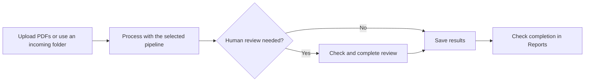

# PDF Processing System: User Guide

Version: 3.13
Release Date: 2026-10-09

This guide is for people who submit documents, check results, and manage the
application through its screens. You do not need programming experience.
**Select** means click or tap an item, or activate it using the keyboard.

Installation, server maintenance, commands, and detailed task settings are in the
[Technical Operations Reference](technical_operations_reference.md) for IT/support.

## Table of Contents

- [History of Changes](#history-of-changes)
- [Quick Start Guide](#quick-start-guide)
  - [Find the right section](#find-the-right-section)
- [1. Overview](#1-overview)
- [2. System Architecture & Data Flow](#2-system-architecture--data-flow)
  - [Components](#components)
  - [Data Flow Diagram](#data-flow-diagram)
  - [What happens to your document?](#what-happens-to-your-document)
- [3. Operator Guide](#3-operator-guide)
  - [3.1. Using the Watch Folder](#31-using-the-watch-folder)
  - [3.2. Using the Web Interface](#32-using-the-web-interface)
  - [Compact upload steps](#compact-upload-steps)
  - [Finding failures from a batch](#finding-failures-from-a-batch)
  - [3.3. Operator Workflows in the Unified App](#33-operator-workflows-in-the-unified-app)
- [4. Administrator Guide](#4-administrator-guide)
  - [4.1. Starting and Stopping Services](#41-starting-and-stopping-services)
  - [4.2. Required Folders and Permissions](#42-required-folders-and-permissions)
  - [4.3. Configuration Management](#43-configuration-management)
  - [4.4. Managing Application Accounts and Passwords](#44-managing-application-accounts-and-passwords)
  - [4.5. Database, State, and Artifact Storage](#45-database-state-and-artifact-storage)
  - [4.6. Log Files and Troubleshooting](#46-log-files-and-troubleshooting)
  - [4.7. Graceful Shutdown and Error Recovery](#47-graceful-shutdown-and-error-recovery)
  - [4.8. Task System: Standard Steps and Parameters](#48-task-system-standard-steps-and-parameters)
  - [4.9. LlamaCloud Extract v2 Structured Data Support](#49-llamacloud-extract-v2-structured-data-support)
  - [4.10. Example Workflows](#410-example-workflows)
  - [4.11. Housekeeping and the Processing Folder](#411-housekeeping-and-the-processing-folder)
  - [4.12. Config Check Validation Tool](#412-config-check-validation-tool)
- [5. Frequently Asked Questions (FAQ)](#5-frequently-asked-questions-faq)
- [6. Appendix](#6-appendix)
  - [Glossary](#glossary)
  - [Technical Page Reference](#technical-page-reference)
  - [Example Configuration Files](#example-configuration-files)
  - [Further Documentation](#further-documentation)

## History of Changes

| Version | Date       | Author              | Description                                                                 |
|---------|------------|---------------------|-----------------------------------------------------------------------------|
| 1.0     | 2025-04-13 | PDF Processing System team | Initial user guide for fixed pipeline system                                |
| 2.0     | 2025-08-01 | PDF Processing System team | Redesigned to configurable task-based workflows via `config.yaml`; web TBD    |
| 2.1     | 2025-08-01 | PDF Processing System team | Added Quick Start guide, simplified explanations, expanded glossary, and improved configuration editing instructions for non-developers |
| 2.2     | 2025-08-01 | PDF Processing System team | Added YAML configuration examples to all 4.7.x subsections for clarity      |
| 2.3     | 2025-08-11 | PDF Processing System team | Implemented and documented web interface for PDF upload and status monitoring|
| 2.4     | 2025-08-20 | PDF Processing System team | Added config-check administrator overview and cross-references to validation docs |
| 2.5     | 2026-06-03 | PDF Processing System team | Updated for the unified operator and administrator interface, SQLite-backed workflow state, review, split, reports, settings, artifact registration, and legacy status endpoint compatibility |
| 2.6     | 2026-06-20 | PDF Processing System team | Updated role guidance, UI-led operator procedures, account recovery, failure handling, split policy explanations, v2 task examples, upload limits, and recovery guidance |
| 2.7     | 2026-06-21 | PDF Processing System team | Consolidated extraction and metadata storage under canonical module and class names while retaining Extract v2 array-of-objects behavior |
| 2.8     | 2026-06-28 | PDF Processing System team | Added typed scalar-list options and flat structured-object extraction with Pipeline editor, validation, review-schema mapping, and operator documentation |
| 2.9     | 2026-07-26 | PDF Processing System team | Documented SQLite-backed, immutable pipeline and review-schema versions, explicit upload selection, watch-folder bindings, exact-version execution, migration, recovery, and stored-definition validation |
| 3.0     | 2026-08-02 | PDF Processing System team | Completed the operator and administrator procedures for multi-pipeline routing, review forms, watch-folder bindings, outputs, validation, settings, audit visibility, and portable definitions; corrected remaining single-pipeline and task-behavior guidance |
| 3.1     | 2026-08-09 | PDF Processing System team | Documented GLM-OCR sensitivity to JSON Schema property order and prompt construction, with controlled-testing and review guidance |
| 3.2     | 2026-08-12 | PDF Processing System team | Documented generic multi-page GLM-OCR document resolution, resolver configuration, schema boundaries, and document-specific pipeline guidance |
| 3.3     | 2026-08-15 | PDF Processing System team | Added visual-editor guidance for multiline extraction values, labelled-block boundaries, adjacent-field exclusions, and focused regression testing |
| 3.4     | 2026-09-03 | PDF Processing System team | Documented the local PDF.js source viewer, provider-specific source-location behavior, and the GLM-OCR resolver context default of 18000 |
| 3.5     | 2026-09-03 | PDF Processing System team | Added upload transfer progress, text confidence bands, and concise screen-reader announcements for dynamic operator updates |
| 3.6     | 2026-09-04 | PDF Processing System team | Added keyboard-friendly upload activation, cancellable uploads, queue retry actions, consistent DaisyUI table styling, and lightweight contextual help |
| 3.7 | 2026-09-08 | PDF Processing System team | Added independent Watch folders management, lifecycle, explicit upgrades, diagnostics, and activity history. |
| 3.8 | 2026-09-27 | PDF Processing System team | Refreshed setup guidance, UI labels, logging, configuration references, and review-form administration instructions. |
| 3.9 | 2026-10-04 | PDF Processing System team | Added generic LiteParse + local Ollama extraction, nullable confidence, diagnostic citations, visual pipeline setup and six-invoice validation guidance. |
| 3.10 | 2026-10-07 | PDF Processing System team | Documented manual PDF splitting and its Review Queue workflow. |
| 3.11 | 2026-10-09 | PDF Processing System team | Retired the read-only Settings screen and documented application settings in Admin Overview and workflow configuration in Pipeline. |
| 3.12 | 2026-10-09 | PDF Processing System team | Documented independent pipeline archiving and processing-history cleanup, protected work, retained files/audits, SQLite space reuse, and draft-preserving metadata/availability saves. |
| 3.13 | 2026-10-09 | PDF Processing System team | Rewrote everyday work and administration around app screens; moved developer and IT instructions into a separate technical reference. |

## Quick Start Guide

### Find the right section

| What you want to do | Where to go |
|---|---|
| Submit PDFs in the browser | [Using the Web Interface](#32-using-the-web-interface) |
| Submit PDFs through an incoming folder | [Using the Watch Folder](#31-using-the-watch-folder) |
| Check or correct results | [Operator Workflows](#33-operator-workflows-in-the-unified-app) |
| Set up a pipeline, review form, or incoming folder | [Administrator Workflow Details](#455-administrator-workflow-details) |
| Archive a pipeline or remove old processing history | [Pipeline retention guide](pipeline_retention_admin_guide.md) |
| Install, restart, or repair the system | Ask IT/support to use the [technical reference](technical_operations_reference.md) |

**Operators:** ask your administrator for the app address, your password, and the
pipeline or incoming folder to use. Sign in, submit the PDFs, and check the batch.
If a document needs review, open **Review Queue** and complete it.

**Administrators:** IT must install and start the application and set up the
initial passwords first. Sign in as **admin**. Check the review form and pipeline,
publish and activate them, then test a representative PDF before inviting
operators to use them. Set up **Watch folders** if automatic intake is needed.

## 1. Overview

The application reads PDFs and saves selected information, such as invoice
numbers, dates, and amounts. A **pipeline** is the ordered set of steps used for
a document type. It can split a PDF, read its fields, pause for a person to check
them, and save the results.

A **batch** is a group of documents submitted together. Each batch uses the
published pipeline version selected at submission. A version is a numbered copy
of the settings. Later changes do not silently change documents already submitted.

An **operator** submits and checks documents. An **administrator** also manages
pipelines, forms, incoming folders, passwords, and application settings. IT/support
handles installation, backups, server restarts, and technical repairs.

## 2. System Architecture & Data Flow

### Components

| Part | What it does for you |
|---|---|
| Upload & Process | Accepts PDFs you submit in the browser |
| Watch folder | Accepts PDFs copied into an approved incoming folder |
| Pipeline | Carries out the steps chosen by the administrator |
| Review Queue | Holds documents that need a person's decision |
| Reports | Helps you find batches and check their progress |
| Output files | Holds the PDFs and exports saved by the pipeline |

### Data Flow Diagram

### What happens to your document?

The app accepts your PDF, follows its pipeline, and records progress. Some
pipelines split a multi-document PDF into separate documents. Some pause for
review. Output locations and file formats depend on the pipeline; ask your
administrator where to find the final files.

## 3. Operator Guide

Operators can upload documents, monitor batches, review information, and use
**Failures** and **Reports**. Administrators can also do this work. Use the
operator account for everyday processing.

### 3.1. Using the Watch Folder

A watch folder is an incoming folder monitored by the application.

1. Ask your administrator which folder to use for your document type.
2. Copy complete PDF files into it. Wait until copying finishes before checking
   their progress. Renaming another file type to end in `.pdf` will not make it a PDF.
3. Open **Reports**, find the batch, and select **Open processing dashboard**.
4. Check each document. Use **Review Queue** for documents awaiting a decision,
   or **Failures** for documents that could not be processed.
5. Open **Extraction** to check saved values and available output files.

The incoming PDF may leave the folder once accepted; this alone does not mean
processing is complete. If a PDF remains there without appearing in Reports,
ask the administrator to check the folder's status and access. Do not repeatedly
copy the same file while its status is uncertain.

Each incoming folder uses a particular published pipeline version. Publishing a
new version does not update the folder automatically; the administrator chooses
when to change it.

### 3.2. Using the Web Interface

**Sign in and upload:**

1. Open the app address provided by your administrator.
2. Select your assigned account, enter its password, and select **Sign In**.
3. Open **Upload & Process** in the left menu.
4. Under **1. Select a pipeline**, choose the correct name and published version.
   Expand **Pipeline details** if you need its instructions. Opening details
   does not select the pipeline.
5. Select or drag PDFs into the upload area. Keyboard users can focus the upload
   area and press **Enter** or **Space** to choose files.
6. Check the file list and remove any unintended file.
7. Select **Start processing**. The batch page opens after acceptance.

Use one pipeline for the whole batch. Submit separate batches for documents that
need different pipelines. If the required pipeline is missing, select **Refresh**
once, then ask your administrator for help.

Unless your administrator changes the limits, you can upload 20 files at once,
with a maximum of 50 MB per file and 200 MB in total. If a batch is too large,
submit fewer or smaller PDFs. If the app is busy, wait briefly and try again.

The transfer percentage describes the upload, not completion of processing.
**Cancel upload** stops the browser transfer, but the app may already have
accepted the batch. If it opens a batch page, check that batch. If the result is
uncertain, keep the same tab open and retry the same files with the same pipeline
as instructed by the app. If you still cannot confirm acceptance, ask an
administrator before starting a separate submission.

**Monitor and check results:**

1. Follow progress on the batch page after submission.
2. To find an earlier batch, open **Reports** and look under **Recent Batches**.
3. Open the batch and select **Open processing dashboard**.
4. Open **Extraction** to compare the PDF and its extracted or reviewed values.
5. Complete any required reviews in **Review Queue**. Check **Failures** if a
   document cannot finish.

The app shows original filenames, statuses, and times. You do not need to manage
its temporary filenames. A **Retry** button beside a loading error reloads that
screen's information; it does not necessarily restart document processing.

### Compact upload steps

Choose a pipeline, add PDFs, then select **Start processing**. Wait for the batch
page and check its progress. A successful upload means the app accepted the
files; it does not mean all processing has finished.

### Finding failures from a batch

Select **View failure details** beside a document when available. This opens its
entry in **Failures**. Check the document's current status as well as the recorded
error: an earlier failure can remain visible after later progress. Opening the
details does not restart processing.

### 3.3. Operator Workflows in the Unified App

The left navigation menu provides the following work areas. If the menu is collapsed, point to an icon to display its name.

**Common processing statuses:**

| Status | Meaning | Operator action |
|---|---|---|
| Queued | Accepted and waiting to start | Wait or monitor the batch |
| Processing | A task is currently running | Monitor the task details |
| Review Required | The document needs a person to check it | Claim, correct, and complete the review |
| Completed | Configured processing finished successfully | Check saved output files and exports |
| Failed | A processing step could not finish | Inspect **Failures** and ask for help; re-upload only after the cause is resolved |
| Paused | Intake or processing was deliberately paused | Contact the administrator if the pause is unexpected |

For split documents, the original may still be processing while documents created from it have
different statuses. An earlier error can remain in the history; always check
the document's current status before retrying. Retries preserve the original
pipeline version and do not silently use the newest publication.

| Menu item | Purpose |
|-----------|---------|
| **Upload & Process** | Upload documents and monitor current or recent batches. |
| **Review Queue** | Correct documents that require human review. |
| **Failures** | Investigate documents that could not be processed. |
| **Reports** | View processing and review activity summaries. |

Administrators also see **Overview**, **Users**, **Pipeline**, **Watch folders**, **Review Forms**, **Task Catalog**, **Validation**, and **Audit Log**. These administrative areas are not available to operators.

**How to use the remaining operator pages:**

- **Processing Overview** is reached automatically after upload or through
  **Reports** > **Open processing dashboard**. It shows pipeline steps, batch/document status,
  and links to extraction, split, review, or failure details as applicable.
- **Extraction** shows the source or stored PDF, saved output files,
  extracted versus final values, confidence bands, review status, and the technical extraction details. **Previous** and **Next** move among documents in the same
  batch. This page is evidence of processing, not an editing screen. When a
  human review is complete, fields that originally required attention are
  labeled **Reviewed**, while operator-corrected fields retain **Corrected**.
  Their confidence labels still describe the original
  machine extraction; they do not indicate outstanding work.
- **Reports** summarizes batches and documents, document statuses, submission
  sources, review counts, completed/failed totals, average processing time, and
  recent batches. Select a recent batch for details and its **Open processing dashboard** link.

#### Human Review

Documents enter the review queue when the system cannot confidently accept the extracted information or when an administrator requires review.

The queue also includes **Manual split** tasks. Its **Review signal** column
shows **Manual task** for page-boundary decisions and confidence for extracted
fields. Operators can complete both kinds of review with their normal account.

1. Select **Review Queue** from the left navigation menu.
2. Use the search and filters to find the document.
3. Select **Claim & review** beside an available document, or **Continue review**
   for one you have already claimed. Claiming reserves it for you. Select **View**
   when you only need to inspect it.
4. If you opened an unclaimed item through **View**, select **Claim** at the top
   before editing. An active claim prevents another operator from editing it.
5. Compare the PDF preview with the extracted fields shown beside it.
   You can scroll the PDF and fields separately. Drag the divider to give either
   side more room, or focus it and use the Left/Right arrow keys. On smaller
   screens, the PDF and fields appear one above the other.
6. Correct inaccurate or missing values.
7. Select **Preview Diff** to review your changes.
8. Select **Save Draft** if the review is incomplete, or **Complete Review** when all information has been checked.
9. After completion, confirm that the document leaves the active queue and continues processing.

A completed review displays **Review complete** and explains that no further
review action is required. Confidence badges remain visible as historical
extraction evidence. **No model confidence** means the extractor did not
provide a confidence score; it does not mean the completed review is pending.

Select a field value or **Show source value** to find its supporting page in
the PDF, when available. Some extraction methods also highlight the source text.
If there is no highlight, compare the value with the PDF yourself. A source link
helps you find the evidence; it does not guarantee that the value is correct.

Review actions have the following meanings:

- **Claim:** reserve the item for the current operator.
- **Release:** return the item to the queue so another operator can work on it.
- **Save Draft:** save corrections without completing the review.
- **Preview Diff:** compare the proposed corrections with the originally extracted values.
- **Complete Review:** submit the corrected values and allow the document to continue.

#### Manual Split Review

1. Find a **Manual split** item in **Review Queue** and select **Claim & split**.
2. Read the pages in vertical order. Select a checkbox between two pages to
   split after the first page. Matching numbered markers appear beside the
   checkbox and in the **Split plan**; select a plan marker to jump to it.
3. Select **Save draft** to pause and return later. Reloading restores the
   saved boundaries. If another session saves a newer draft, renewals preserve
   your visible unsaved selections but require a reload before saving or
   approving them.
4. Select **Confirm split** when the boundaries are correct. Each resulting
   document continues through the remaining pipeline steps. Once **Decision
   saved** appears, you can leave the form; **View processing** opens the
   dashboard while extraction and later review steps continue.
5. For a single invoice spanning multiple pages, leave every checkbox clear
   and select **Continue without splitting**. The original document continues
   through the remaining steps as a single document. One-page PDFs skip manual split review automatically.

Completed decisions are available in **History**. **Retry continuation**, when
shown, handles eligible unstarted work; it does not repeat steps that have already started.
Follow the displayed message if an active attempt requires administrator repair.
See [Manual PDF split task](manual_split_task.md) for setup and recovery details.

#### Review Gate Example

If the administrator sets a 90% review threshold, a field covered by that rule may require review when its confidence is below 90%. For example:

1. The system extracts an invoice amount with 86% confidence.
2. Because this is below the configured 90% threshold, the document appears in **Review Queue**.
3. An operator selects **Review Queue**, claims the document, and compares the amount with the PDF preview.
4. The operator corrects the amount if necessary and selects **Preview Diff**.
5. After the operator selects **Complete Review**, the button changes to **Saving review…** and the page shows **Saving review and finishing workflow…** while the corrected information is saved and processing continues. Keep the page open until the review queue appears; the button is disabled during this operation to prevent duplicate submissions. If the save fails, the action controls become available again and an error message explains what happened.

The review queue opens on **Needs review**, with ownership filters for
**Unclaimed**, **Assigned to me**, and **Claimed by others**. Expired claims
become available again. **Claim & review** starts an available review;
**Continue review** opens your active claim. Completed reviews are in **History**.

Both views support pipeline/search filters, sortable column headers, and
Previous/Next pagination with 10, 25, 50, or 100 rows per page. Sorting applies
to all matching records before pagination. Changing filters or page size
returns to page one and preserves the selected sort.

#### Schema-Based Review Migration

If your organisation previously used a separate review program, use **Review
Queue** in this application for daily review. Administrators maintain the fields
and layout under **Review Forms**. Ask the administrator if a familiar field or
saved review is missing after an upgrade.

#### Split Results

When split processing is enabled, one uploaded PDF may create several child documents. The system processes each child separately after the split. One child may finish while another is still processing or waiting in **Review Queue**. Finishing the split does not mean that all child documents have finished; the original PDF is complete only after every child has reached a final status.

If the splitting step identifies a single document containing all the pages in
order, the original PDF continues through the remaining steps as one document. Split Results shows **No split needed**, the
category and confidence, and **View Extraction** for the original document.
Its status still reflects later processing steps, review, or failure.

**Documents Created**, **Successful Children**, and **Failed Children** describe
generated children. The separate **originals continued** count identifies
original PDFs that continued as one document. Zero created children alone does
not mean a successful single-document classification; splitting may have been
skipped or returned no segments.

To check progress, select **Reports**, open the batch's **Open processing dashboard** view, and
select **View Split Results**. This page shows:

- source document status
- child document IDs
- split category and confidence
- page ranges
- links to extraction results for child documents or the original when no split is needed

#### Failures

Use **Failures** when a document cannot complete processing:

1. Select **Failures** from the left navigation menu.
2. Find the document by filename, batch, or failure details.
3. Open the failure to see the failed processing step, explanation, and suggested operator action.
4. Correct the source document or ask an administrator to correct the configuration, as appropriate.
5. Re-upload the document only after the cause has been addressed.

Repeated failures from child documents may be grouped under their original source PDF so that operators can investigate one source-level problem.

## 4. Administrator Guide

Sign in as **admin** to see the Admin menu. The steps below use the app screens.
Ask IT/support for help with installation, server access, credentials for outside
services, backups, and repairs.

### 4.1. Starting and Stopping Services

The app has no server Start or Stop button. Ask IT/support to start, stop, or
restart it. Signing out or closing your browser does not stop incoming-folder
processing.

Before planned maintenance, tell operators to stop submitting files and pause
incoming folders under **Watch folders**. Pausing a folder prevents new intake;
it does not cancel work already accepted. Agree with IT when current processing
can be interrupted. After maintenance, check **Reports**, **Review Queue**, and
folder health before resuming intake. Do not re-upload documents solely because
the app restarted.

### 4.2. Required Folders and Permissions

Ask IT to provide the incoming and output folders and allow the application to
access them. A folder you can open on your own computer may still be inaccessible
to the computer or account running the app.

#### 4.2.1 Pre-existing vs Auto-created folders (consolidated)

Use an existing, approved folder when adding a watch folder. In **Watch folders**,
select **Add watch folder**, enter the supplied path, and select **Test access**.
If access fails, give IT the path and displayed message. Do not change permissions
or create replacement folders without coordinating with them. Output folders
depend on the pipeline's storage steps; confirm their location before live use.

### 4.3. Configuration Management

#### 4.3.1. High-level Structure

| What you need to change | App page |
|---|---|
| General settings available to admins | **Overview**, under **Non-secret Settings** |
| Document-processing steps | **Pipeline** |
| Fields people check during review | **Review Forms** |
| Incoming folders and their pipeline versions | **Watch folders** |
| Account passwords | **Users** |
| Available processing steps | **Task Catalog** |

#### 4.3.2. Global Sections

Open **Overview**, find **Non-secret Settings**, change the relevant value, and
select **Save Settings**. Check the success or error message before leaving.
Only settings offered there can be changed through this screen. Ask IT to change
server settings or connections that are not shown. Never paste service passwords
or API keys into ordinary description fields.

#### 4.3.3. Pipeline Configuration

A pipeline has a draft, published versions, and an availability status. Editing
a draft does not change a published version. **Save Draft** saves your work;
**Validate** checks it; **Publish** creates a numbered version. Activation makes
eligible published versions available for uploads. Incoming folders keep their
chosen version until you explicitly update them.

To rename a pipeline, open **Pipeline**, select it, edit **Name**, and leave the
field to save it. Check the save message and displayed name. Its stable key stays
the same, so existing records remain associated with the pipeline.

To stop future use, archive the pipeline. To remove eligible old processing
history, use the separate cleanup action. Archiving retains history and files.
Cleanup removes eligible history but retains output files and audit records;
it does not automatically shrink the database file on disk.

Follow the [archive walkthrough](pipeline_retention_admin_guide.md#archive-a-pipeline)
and [processing-history cleanup walkthrough](pipeline_retention_admin_guide.md#clean-up-processing-data).
Permanent pipeline deletion is not available.

### 4.4. Managing Application Accounts and Passwords

The app has two fixed accounts: **admin** and **operator**. Their names and roles
cannot be changed.

#### First-Time Account Setup

IT/support sets the first passwords before you sign in. Ask for them through your
organisation's approved channel. Do not put passwords into screenshots or guides.

#### Change a Password Normally

1. Sign in as **admin** and open **Users**.
2. Find the card for the account you want to change.
3. Enter the current **administrator** password in the first password field.
   This is required for either account. The Operator card currently labels this
   field **Current Operator password**, but it requires the admin password.
4. Enter and confirm the new password.
5. Select **Change admin password** or **Change operator password**.
6. Check the confirmation message. Existing sessions for that account are signed
   out; sign in again if you changed the admin password.

#### Recover Access When the Administrator Cannot Sign In

Ask IT/support to reset access. The recovery procedure replaces passwords for
both accounts, so arrange new sign-in details for operators too.

#### Password and Login Rules

Use a unique password with uppercase and lowercase letters, a number, and a
symbol. With ordinary English letters, numbers, and symbols, the length must be
12–72 characters. Other characters may reach the maximum sooner; follow the
app's validation message. The new password must differ from the current one.
After repeated failed sign-ins, wait for the stated cooldown before trying again.

#### Production Web Hardening

IT/support manages secure access and server protection. Use the approved app
address and report unexpected certificate or sign-in problems to them.
Technical settings are in the [IT reference](technical_operations_reference.md#production-web-hardening).

### 4.5. Database, State, and Artifact Storage

The app keeps processing history and settings separately from PDF and export
files. Removing history does not delete those files. A complete backup needs
both kinds of information; ask IT/support to arrange it.

#### 4.5.1. Database Initialization

IT prepares and upgrades the database. No database setup is required for normal
use of the app. If a database error prevents sign-in or processing, record the
message and contact support.

#### 4.5.2. What SQLite Stores

SQLite is the app's database. It holds accounts, settings, pipeline versions,
processing progress, extracted values, reviews, and audit records. You access
these through the app; you do not need to open the database yourself.

#### 4.5.3. Filesystem Artifact Boundaries

PDFs and CSV or JSON exports are stored as files. CSV exports can be opened in
spreadsheet software; JSON exports are usually used by other systems. A document's
**Extraction** page lists available output files. Ask IT before moving or deleting
them, because the app may still refer to their saved locations.

#### 4.5.4. Operator and Administrator State Views

Use **Reports** for batches, the processing dashboard for document progress,
**Review Queue** for pending decisions, and **Failures** for errors. Use **Pipeline**,
**Review Forms**, and **Watch folders** for their current settings and versions.

#### 4.5.5. Administrator Workflow Details

##### Create and publish a pipeline visually

1. Open **Pipeline** and select **New**.
2. Enter a **Stable pipeline key**, such as `invoice-processing`. Use lowercase
   letters, numbers, and hyphens, starting with a letter. This identifier cannot
   be renamed later. Enter a friendly **Pipeline name**.
3. Select **Create pipeline**. Set **Name**, **Document type**, and **Description**
   as needed; leave each field to save its metadata.
4. In **Editing draft**, select **Add task**, choose the required step, and select
   **Add**. Select a step to edit its properties. Use **Up**, **Down**, **Enabled**,
   or **Remove** to organise the steps.
5. Select **Save Draft**, then **Validate**. Resolve any reported errors. Ask IT
   for help with technical task properties or named service connections.
6. Select **Publish**, check the confirmation, and select **Publish version**.
7. Select **Activate for uploads** when offered, or set **Availability status**
   to **Active**. Publishing by itself does not make the pipeline active.
8. Submit a representative PDF through **Upload & Process** and check its values,
   reviews, and saved files before using the pipeline for routine work.

For an existing pipeline, select it and edit its draft. **Diff** compares your
draft with its published version. **Refresh** can discard unsaved work.
**Reset draft to published version** replaces draft edits with the published
settings; save the resulting draft if you intend to keep that reset.
**Clone** starts a separate pipeline from the latest published version.
Importing a definition changes a draft; validate and publish it before use.

##### Create and publish a review form visually

1. Open **Review Forms** and select **New Review Form**.
2. Enter a **Stable key** and **Review form name**, then select **Create review form**.
3. Set the form's **Title** and **Description**.
4. Add fields using **String** for text, **Number** for numeric values, **Boolean**
   for yes/no, or **Enum** for a choice from a list. **Object** groups related
   fields; **Array** holds repeating items, such as invoice lines.
5. Set each field's key and label. Keys must match the information extracted by
   the pipeline. Ask support if you are unsure which keys to use.
6. Select **Save draft**, then **Validate**. Fix errors and select **Publish**.
7. Set **Lifecycle** to **Active** when the form is ready for use.
8. Open the pipeline draft, select its review step, and choose the required
   **Published review form version**. Save, validate, and publish the pipeline.
9. Test a document that requires review and check the fields in **Review Queue**.

Changing the form alone does not change the form version already selected by a
published pipeline. Existing documents retain their assigned versions.
Use **Version history & dependencies** to inspect versions and where they are used.
Import and export are available for transferring definitions with IT/support.

##### Add a watch-folder binding visually

A binding is the saved assignment of an incoming folder to a pipeline version.

1. Open **Watch folders** and select **Add watch folder**.
2. Enter the **Folder path** supplied by IT and select **Test access**.
3. Choose the **Pipeline** and its **Published version**.
4. Set **Watch folder enabled** as required and select **Save changes**.
5. Check the row's status and health. Submit a test PDF and find its batch in
   **Reports** to confirm that intake and processing work.

Use **Edit** to change a binding. To adopt a newly published pipeline version,
select **Use latest version**, then **Save changes** and **Confirm** when asked.
The change applies to future intake, not documents already accepted.

Use the row's **Pause** or **Resume** action to control intake and confirm the
change. **Check now** checks folder access; it does not submit a document or prove
that processing is running. **Activity** shows recent binding activity. If health
stays stale or files are not picked up, contact IT/support.

In **Edit**, **Unbind pipeline** removes the assignment while reserving the folder
path. **Retire binding** ends use of that binding and releases its path for a new
one. Confirm either action when prompted. Use **Show retired** to see retired rows.
**Delete unused binding** is available only when no historical batches refer to
it. These actions do not delete the folder or its PDFs.

Search folders or pipelines and use the status, health, and **Updates available**
filters to find the rows you need. Select **Refresh** to reload the list.

##### Use Overview, Task Catalog, and Validation

**Overview** provides application information and **Non-secret Settings**. Save
setting changes with **Save Settings**. Use **Pipeline** and **Review Forms** for
their complete lists rather than relying on overview summary counts.

**Task Catalog** lists the available processing steps. Search for a step and check
whether it is **Importable**. **Add in Pipeline** opens the editor; you must still
add the task to the draft. Give support the task name if it cannot be loaded.

Use **Validate** inside **Pipeline** or **Review Forms** to check the draft you are
editing. The separate **Validation** page provides additional diagnostic checks
for IT/support. Its **Check config.yaml** action checks a configuration file; it
does not check every published pipeline. A validation result does not save, repair,
or publish settings. Leave advanced options at their defaults unless support
instructs you otherwise.

##### Administrator Audit History

1. Open **Audit Log**.
2. Filter by **Event Type**, **User**, **From**, or **To**, then select **Apply**.
3. Select **Details** on a relevant row to inspect the recorded change.
4. Use **Previous** and **Next** for more rows, **Clear** to remove filters, or
   **Refresh** to reload the list.

This screen displays selected types of administrative events; it does not expose
every saved audit record. An empty result does not prove no change occurred.
Ask support for a fuller investigation if needed. Use **Reports** for document
processing history.

#### 4.5.6. Backup and Recovery

Ask IT/support to arrange regular backups and a backup before upgrades or history
cleanup. There is no full-system Backup or Restore button in the app. Exporting a
pipeline or review form saves its definition, not documents or processing history.

Coordinate restoration with operators: restoring an older backup can remove
later changes from the restored system. After recovery, check recent batches,
reviews, pipeline versions, incoming folders, and output files before resuming.

### 4.6. Log Files and Troubleshooting

| Problem | What to do in the app |
|---|---|
| A pipeline is missing from upload choices | Select **Refresh**, then check its published versions and availability in **Pipeline** |
| A document needs checking | Claim it in **Review Queue**, correct it, and complete the review |
| A document failed | Open **Failures**, read the reason, and address the cause before resubmitting |
| A folder is not taking in files | Check its status, selected version, health, and **Activity** in **Watch folders** |
| A draft cannot be published | Select **Validate** in its editor and fix the reported issues |
| A screen cannot load its data | Use its **Retry** or **Refresh** action, then contact support if it persists |

For support, record the filename, pipeline and version, approximate time, screen,
and error message. Share sensitive document content only through an approved
channel. Never include passwords or service keys. IT can inspect the application
logs using the [technical reference](technical_operations_reference.md#46-log-files-and-troubleshooting).

### 4.7. Graceful Shutdown and Error Recovery

Pause new intake and ask IT to stop the system for maintenance. After an unexpected
interruption, check existing batches before submitting replacements. Saved queued
work may continue after restart. If progress remains stuck, give support the batch
and document details rather than deleting temporary files yourself.

### 4.8. Task System: Standard Steps and Parameters

A task is one step in a pipeline. Add and arrange tasks in **Pipeline**, select a
step, and edit its properties. Save and validate the draft before publishing.
The names below help you identify tasks in the editor and in failure messages.
For detailed properties and examples, IT/support can use the
[task reference](technical_operations_reference.md#48-task-system-standard-steps-and-parameters).

#### 4.8.1. extraction

Reads selected information from the PDF. Choose the approved extraction method
and fields for your document type. Test several representative documents and
check their values before routine use. Ask support to set up service connections.

##### GLM-OCR extraction (local Ollama)

This method uses a locally hosted model. It does not provide a numeric confidence
score. Use human review where correctness needs confirmation. Technical setup is
in the [GLM-OCR reference](technical_operations_reference.md#glm-ocr-extraction-local-ollama).

##### LiteParse extraction (local Ollama)

This method also uses a locally hosted model and does not provide numeric field
confidence. Check values against the PDF; source links alone do not establish
correctness. See the [LiteParse reference](liteparse_extract_task.md) for IT setup.

#### 4.8.2. split.llamacloud_split

Separates a PDF containing several documents into individual documents using
configured categories. Check **View Split Results** on the processing dashboard.
For splitting by a person's page choices, use the
[Manual split workflow](#manual-split-review) instead.

#### 4.8.3. storage.store_metadata_as_csv

Saves extracted or reviewed information in CSV files for spreadsheet use. Set the
output location with IT and check the exported columns during a test run.

#### 4.8.4. storage.store_metadata_as_json

Saves information in JSON files for other systems. This format can retain grouped
fields and repeating items. Ask the receiving system's owner to confirm the format.

#### 4.8.5. storage.store_file_to_localdrive

Saves a PDF to the configured output location. Agree the destination and filename
rules with IT, then check the file from the document's **Extraction** page.

#### 4.8.6. archiver.archive_pdf

Moves the processed PDF to an archive location chosen in the pipeline. This task
archives a document file; archiving a pipeline is a separate administrator action.

#### 4.8.7. rules.update_reference

Updates configured reference information used by later steps. Ask support to
confirm the field mappings and reference source before changing it.

#### 4.8.8. review.review_gate

Pauses processing when review rules require a person to check the document.
Choose the published review form version and review policy in the step's
properties. Put review before the final exports if exports should use corrected
values. Test both a document that needs review and one that can pass automatically.

#### 4.8.9. Assign Nanoid (standard_step/context)

Assigns a short unique reference for use in later steps, such as file naming.
Ask support which reference field subsequent tasks should use.

#### 4.8.10. housekeeping.cleanup

Removes eligible temporary processing files according to the task's settings.
It is separate from removing old processing history in the admin cleanup dialog.
Do not use it as a substitute for a backup or a document-retention policy.

#### 4.8.11. Validation and Failure Behavior

Validation finds many missing or incompatible settings before publication, but
cannot guarantee a service or output folder will be available during processing.
Test a representative PDF after changes. Investigate failed steps under **Failures**.

### 4.9. LlamaCloud Extract v2 Structured Data Support

Some extraction setups support grouped fields and repeating lists, such as an
address or invoice lines. The review form and export steps must match the
information being extracted. Ask support to check this when introducing a new
document type. The [technical reference](technical_operations_reference.md#49-llamacloud-extract-v2-structured-data-support)
describes supported formats and limitations.

#### 4.9.1. Flat objects

Groups related values, such as a supplier's name and address, under one heading.

#### 4.9.2. Scalar lists

Holds several values of one kind, such as a list of reference numbers.

#### 4.9.3. Arrays of objects

Holds repeating groups, such as invoice lines with a description, quantity, and
amount. Check every row during review. Confirm with the recipient how repeating
information should appear in CSV exports; JSON can keep the grouped structure.

#### 4.9.4. Migration Guide

Ask IT/support to convert older extraction setups. Test the new pipeline and form
with representative PDFs, then explicitly update incoming folders when ready.

#### 4.9.5. Current Limitations

Not every extraction method supports the same field types or confidence scores.
Use the editor's validation and ask support about unsupported combinations.

### 4.10. Example Workflows

For invoices that need checking, a typical pipeline is:

1. Split the PDF if it contains several invoices.
2. Extract the invoice fields.
3. Pause for review when required.
4. Save the reviewed information and PDF to approved output folders.
5. Clean up temporary files if configured.

Build the draft in **Pipeline**, save and validate it, then publish and activate it.
Test a sample through **Upload & Process**. Complete any review, then confirm the
saved values and files. Add an incoming-folder assignment only after the test
produces the expected results.

### 4.11. Housekeeping and the Processing Folder

Temporary processing files, final business files, and processing history are
different kinds of information. Do not manually empty processing folders while
the application is running. Ask IT to investigate storage usage.

For old history, follow the [processing-history cleanup walkthrough](pipeline_retention_admin_guide.md#clean-up-processing-data).
Review the preview before confirming. Protected or active work is excluded.
Deleted database space can be reused; shrinking the database file requires a
separate IT maintenance operation. Cleanup does not remove saved PDFs or exports.

### 4.12. Config Check Validation Tool

For normal administration, select **Validate** in the **Pipeline** or **Review
Forms** editor before publishing. If support requests a wider configuration check,
use the **Validation** page as directed and share its findings. The command-line
tool is for IT/support and is described in the
[technical reference](technical_operations_reference.md#412-config-check-validation-tool).

## 5. Frequently Asked Questions (FAQ)

**Which pipeline should I choose?**

Use the name and version approved for your document type. Read **Pipeline details**
or ask the administrator. Do not select a similar pipeline just to continue.

**Why is my pipeline missing?**

Select **Refresh**. The administrator should check that it has an eligible
published version and is active. Archived pipelines are unavailable for new use.

**Does publishing a new version change existing documents or incoming folders?**

No. Existing documents keep their assigned version. Administrators explicitly
change a watch folder's selected version for future intake.

**Is uploading the same as completing processing?**

No. Check the batch status and complete any required reviews. Split PDFs can
produce several documents that finish at different times.

**What does “No model confidence” mean?**

The extraction method did not provide a score. Compare the value with the PDF.
After a review is complete, that label can remain as a description of the original
extraction; it does not mean another review is needed.

**Does Save Draft finish a review?**

No. It saves your progress. Select **Complete Review** when the information has
been checked. For manual splitting, use **Confirm split** or **Continue without
splitting** as appropriate.

**Can I fix values on the Extraction page?**

That page shows results and evidence. Make permitted corrections through the
claimed review in **Review Queue**.

**What if an upload was cancelled or the browser lost connection?**

Check whether the app opens an accepted batch. If acceptance is uncertain, follow
the same-tab retry guidance in [Using the Web Interface](#32-using-the-web-interface)
and ask an administrator if you still cannot confirm it.

**Where are my output files?**

Open the document's **Extraction** page to see available files. Ask the
administrator for the pipeline's output location if you need folder access.

**Can I rename or archive a pipeline without losing its history?**

Yes. Renaming updates its display name. Archiving prevents future use and retains
history. Removing eligible old processing history is a separate cleanup action.

**Will cleanup free disk space immediately?**

It frees space inside the database for reuse. The database file usually stays the
same size until IT performs compaction. PDFs and exports remain on disk. See the
[retention guide](pipeline_retention_admin_guide.md) for the cleanup steps and limits.

**Can an archived pipeline be permanently removed?**

Permanent pipeline deletion is not available. You can keep it archived and remove
eligible old processing history separately.

**Does the app need internet access?**

Pipelines using cloud services need access to those services. Locally hosted
extraction can run without sending documents to a cloud extraction service.
Ask IT which method your pipeline uses and what network access it requires.

**What if I forget my password?**

An administrator can change the operator password under **Users**. If the admin
cannot sign in, IT/support must recover access for both accounts.

**Should I re-upload a failed document?**

Read **Failures** and address the cause first. Check current progress before
resubmitting, particularly after an interruption or a split. Ask the administrator
when you are unsure whether work has already completed.

## 6. Appendix

### Glossary

| Term | Plain-language meaning |
|---|---|
| Batch | Documents submitted together |
| Pipeline | Ordered processing steps for a document type |
| Task | One processing step |
| Draft | Settings you are still editing |
| Published version | A numbered copy of settings ready to be used |
| Active | Available for eligible new use |
| Archived pipeline | A pipeline retained for history but unavailable for new use |
| Watch folder | An incoming folder the app monitors for PDFs |
| Binding | Assignment of a watch folder to a pipeline version |
| Review form | Fields and layout used when checking extracted information |
| Claim | Reserve a review so you can edit it |
| Confidence | The extraction method's estimate of certainty, when provided |
| Child document | A document created by splitting an original PDF |
| Artifact | A saved file produced or used by processing |
| CSV | A file format commonly opened in spreadsheet software |
| JSON | A structured data format commonly exchanged with other systems |
| SQLite | The database used to store app settings and processing records |
| Audit log | Records of actions and changes |
| Stable key | An identifier that stays the same when a display name changes |
| Credential alias | A name referring to a service connection configured by IT |

### Technical Page Reference

Use the left menu to open **Upload & Process**, **Review Queue**, **Failures**,
and **Reports**. Administrators also see **Overview**, **Users**, **Pipeline**,
**Watch folders**, **Review Forms**, **Task Catalog**, **Validation**, and **Audit Log**.
Direct web addresses and API details are in the
[IT page reference](technical_operations_reference.md#technical-page-reference).

### Example Configuration Files

Examples and technical task settings are in the
[Technical Operations Reference](technical_operations_reference.md#example-configuration-files).
For everyday changes, use the app editors. Import a definition only when you know
its intended purpose, then validate and test it before routine use.

### Further Documentation

- [Pipeline archiving and processing-history cleanup](pipeline_retention_admin_guide.md): administrator app walkthroughs.
- [Review form administration](review_schema_admin_guide.md): detailed form guidance, including advanced reference material.
- [Manual PDF splitting](manual_split_task.md): page-selection workflow and technical setup.
- [Technical Operations Reference](technical_operations_reference.md): IT setup, maintenance, and task parameters.
- [Architecture reference](design_architecture.md): application design for developers and support.
