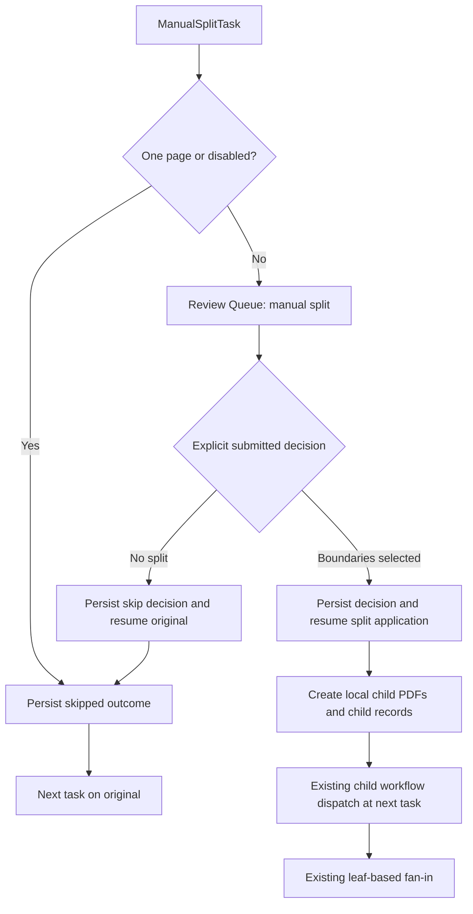

# Manual PDF split task: proposed design

Status: **Approved; implemented. See [operations and recovery limits](../docs/manual_split_task.md) and [implementation checklist](tasks-manual-split.md).**

Date: 2026-10-07

## 1. Intended behavior

Add `standard_step.split.manual_split.ManualSplitTask` as an alternative to
the existing cloud split task. For a PDF with multiple pages, pause processing
and ask an operator to select boundaries in the existing Review Queue. Split
locally after approval and use the existing child-workflow and fan-in behavior.

The manual task owns both the request for a human decision and its application.
Administrators configure one manual split step; they do not need to add an
extraction review gate to make splitting work. An extraction review gate can
still appear after extraction for each resulting document.

| Situation | Review item | Result | Downstream execution | Children / child workflows |
| --- | --- | --- | --- | --- |
| PDF has exactly one page | None | Skipped: `single_page` | Next task on the original document, in the current flow | Zero |
| PDF has multiple pages; no approved decision | Manual split item | Paused for boundary selection | No downstream tasks yet | Zero |
| Operator chooses **Continue without splitting** | Completed item | Skipped: `operator_no_split` | Next task on the original document after review resume | Zero |
| Operator confirms one or more boundaries | Completed item | Split completed | Each child starts at the next configured task | One per resulting segment |
| Task disabled | None | Skipped: `disabled` | Next task on the original document | Zero |
| Invalid, empty, unreadable, or unsupported encrypted PDF | None, or existing decision remains unapplied | Task failure | Configured failure policy; recommended `stop` | Zero |

Skipping preserves the original document ID, file path, filename, pipeline
assignment, and business context. It does not create a copy of the whole PDF,
set `pipeline_state = fan_out`, or mark the document `split_completed`.

**Meaning of “no spawning” in this design:** skipped work creates no child
workflows. The one-page case continues in the already-running Prefect flow.
After an operator declines splitting, the app must start one continuation flow
for the original document because its current human-review architecture ends
the original run when pausing. This is the same application-level resume model
used by extraction review, rather than a live suspended Prefect run.

## 2. Existing behavior and integration constraints

The maintained documentation and current code establish these constraints:

- SQLite owns document, task-run, review, and aggregate state. Prefect wraps
  execution; it is not the authoritative workflow-state store.
- A review pause returns before downstream tasks or cleanup. Completion starts
  a new flow from persisted state and the exact assigned pipeline version.
- `ResumeManager` currently always resumes at the next task and discards the
  returned flow context. `WorkflowManager` currently handles returned
  `fan_out` contexts when launching root work. Manual review therefore needs a
  specific resume target and access to the same fan-out dispatch path.
- `ReviewService` currently requires an exact extraction review-schema
  dependency for versioned reviews and completes reviews by applying field
  corrections. A manual split item needs a distinct, typed payload and
  validation path.
- The cloud split task already creates PDFs and child rows, reuses existing
  children, pins child pipeline versions, compensates partial failures, and
  signals fan-out. Some of that implementation currently lives inside the
  cloud task and must become reusable.
- Task runs currently use `running`, `paused`, `completed`, and `failed`.
  **Skipped is a task outcome, not a new global task-run or document status.**
- The pipeline allows at most one split, one extraction, and one extraction
  review-gate task; splitting precedes extraction. The manual task counts as
  the split step, so a pipeline cannot contain both cloud and manual splitting.
- Production pages already use locally served PDF.js and authenticated,
  same-origin PDF previews. The existing PDF viewer creates a vertical page
  sequence that can gain optional boundary controls.

Documentation consulted: [architecture](../docs/design_architecture.md),
[user guide](../docs/user_guide.md),
[review-schema administration](../docs/review_schema_admin_guide.md),
[frontend deployment](../docs/frontend_deployment.md), and
[task creation guidelines](standard_task_creation_guidelines.md).
The [single-document split plan](plan-single-document-split-continuation.md)
also records the existing continuation and child-count regression requirements.

## 3. Operator experience

### Review Queue

Retain the existing table, ownership filters, pipeline selection, search,
pagination, and claim behavior. Make only the agreed additions:

| Queue element | Manual split item |
| --- | --- |
| Document | Filename, **Manual split** badge, and “18 pages · Choose split boundaries” |
| Fields to check | An em dash |
| Review signal | **Manual task**; no numeric confidence |
| Action | **Claim & split**, **Open split**, or **View split**, according to lock/status |

Rename the existing **Lowest Confidence** header to **Review signal**.
Extraction rows retain their current confidence badges and field lists.
Sorting remains server-side: numeric confidences retain their existing order,
manual signals are grouped consistently after scored items, and the column
explains that manual tasks do not have a confidence score.

The existing `/app/review/{review_item_id}` route selects the appropriate
template from the persisted review kind. Completed split decisions appear in
History as read-only plans. Claim/release, expiry, and another operator's lock
work as they do for extraction review.

### Manual split form

- One PDF page per row: page 1, checkbox, page 2, checkbox, page 3, and so on.
  All pages remain available in vertical source order. No page grid.
- Each gap has one checkbox: **Split after page N**. There is no checkbox
  before the first page or after the last page.
- Checked boundaries get a purple separator and a numbered marker. The
  matching boundary in the split plan has the same number, text, and color.
  Numbers and text keep the association understandable without color.
- The split plan updates immediately. For an 18-page PDF, boundaries `[2, 6]`
  produce **Document 1: pages 1–2**, **Document 2: pages 3–6**, and
  **Document 3: pages 7–18**.
- Clicking a plan boundary scrolls to its checkbox. The last changed boundary
  receives a brief emphasis in the plan. Removing a boundary merges the
  adjacent ranges and renumbers the remaining markers.
- **Save draft** persists selections without starting work. **Release** returns
  the item to the queue without erasing its draft. **Back to queue** navigates
  away; it does not silently submit or reset the plan.
- With boundaries selected, the primary action is **Confirm split**. With no
  boundaries, it becomes **Continue without splitting**, with the explanation
  “The original PDF will continue to the next task.” An empty draft alone
  never skips the task: the operator must explicitly submit that action.
- During submission, disable edits and show **Saving decision…**, followed by
  **Applying split…** or **Continuing document…** as applicable. Show decision
  acceptance separately from downstream execution failure.

Use real PDF.js pages, fit-width/zoom controls, labeled keyboard-operable
checkboxes, visible focus, and an accessible live split-plan summary. Render
page canvases near the viewport where practical while retaining every page
placeholder and every boundary control. Checking a boundary must not rebuild
the PDF or reset the user's scroll position.

## 4. Task configuration and pipeline placement

Proposed task parameters:

| Parameter | Default | Purpose |
| --- | --- | --- |
| `enabled` | `true` | Allow explicit disabling with a durable skipped outcome |
| `split_dir` | Required | Local destination for generated child PDFs |
| `queue_name` | `default_review` | Existing review-queue grouping |

One-page skipping and continuing without splitting are guaranteed behavior,
not options that can accidentally be disabled. No API key, provider, category
list, extraction schema, or configurable resume policy is required.

Example published pipeline structure:

```text
manual_split
  → extraction
  → extraction_review_gate (optional; pins its own review-schema version)
  → storage / archiving / other configured tasks
  → managed cleanup
```

The manual task is approved through the standard task registry, appears in the
task catalog and Pipeline editor, and participates in both publication and
config-check validation. It is classified as `split`, even though it can
request human work. Existing immutable cloud pipeline versions remain valid.

Boundary selection does not classify document contents. Keep confidence null;
preserve an existing document type where applicable. Do not invent `high`
confidence or an `invoice` category. Pipelines needing automatic category
routing will need a separate design; this first release only separates pages.

## 5. Persisted model

### Typed review items

Add `review_items.review_kind` with allowed values `extraction` and
`manual_split`; migrate existing rows to `extraction`.

Extraction review keeps its exact schema-version and content-hash checks.
Manual split instead validates its originating approved task key, task index,
task-run identity, document, and pinned pipeline version. It uses a versioned
fixed boundary-payload contract, so `review_schema_version_id` remains null.
This is a narrow type-specific rule, not a relaxation of extraction validation.

Review creation and document pausing must commit together. Prevent duplicate
open manual work by the logical task identity, not just the current attempt's
task-run ID: retries can have different task-run IDs.

### Manual split decision records

Add `manual_split_decisions`, managed by a repository in
`modules/db/repositories.py`, with:

- ID, document ID, exact pipeline version, task key/index, optional review item
  ID, originating task-run ID, and contract version.
- Source PDF SHA-256, page count, and registered source artifact ID.
- Draft boundary list and revision for optimistic concurrency.
- Final action (`split` or `skip`), immutable approved boundaries, skip reason,
  reviewer, and decision time.
- Application phase (`pending`, `applying`, `applied`, or `failed`) and safe
  failure/recovery information; child IDs are obtained from persisted child
  rows and linked to this decision.
- A bounded, explicitly selected business-context checkpoint needed after
  pausing, including upstream `data` and supported metadata. Identity and
  file/version paths are restored from authoritative records. Never serialize
  task parameters, secrets, configuration objects, or the whole context.

Use a unique identity across document, pinned version, configured task key, and
source fingerprint. A changed source is a conflict requiring investigation;
it must not silently create a new decision for the same waiting review.

One-page and disabled skips also persist an outcome but need no review item.
Final approval is immutable. Retrying completion with the same decision is
idempotent; an attempt to replace it with different boundaries returns a
conflict. Draft and completion writes validate the expected revision and
current lock owner in the same transaction.

Keep PDFs on disk. Persist only page-number decisions, business checkpoints,
operational records, and redacted audit metadata in SQLite.

## 6. Execution and resume design

### First execution

1. Validate task identity, source, and injected parameters. Use local `pypdf`
   to read the page count; do not contact an external service.
2. If disabled, persist `skipped / disabled` and continue.
3. If there is one page, persist `skipped / single_page` and continue on the
   original document. Do not enqueue review or set pause/fan-out keys.
4. For multiple pages, reuse a matching pending review or accepted decision.
   Otherwise register/preserve the source, save its fingerprint and safe
   checkpoint, create a `manual_split` review item, and pause atomically.
5. Return `pipeline_state = paused` and the review item ID. The loader records
   the task attempt as paused and returns before cleanup or downstream work.

### Approval and application

1. The manual review completion service validates lock ownership, source
   fingerprint, task/version identity, revision, action, and boundaries.
2. In one transaction, persist the immutable decision, complete the review
   item, mark its waiting task attempt completed with
   `phase = decision_accepted`, and move the document to `review_completed`.
   No extraction corrections are applied.
3. `ResumeManager` selects an internal resume strategy from the review kind:
   extraction review still starts at the next step; manual split re-enters
   the exact manual task with the accepted decision.
4. Atomically acquire `review_completed → resuming`, rebuild the safe context,
   and start the assigned version at that task index. Re-entry creates a
   separate task attempt linked to the decision and waiting attempt, so PDF
   application has its own running/completed/failed record.
5. The task finds the final decision and applies it without creating another
   review. For `skip`, return `skipped / operator_no_split` and continue the
   original document from the next task. For `split`, materialize children and
   return the existing fan-out protocol.
6. Route the returned context through shared workflow outcome handling. This
   is necessary because today's `ResumeManager` does not dispatch fan-out.

The duplicate-resume check must distinguish the completed waiting attempt
(`decision_accepted`) from completed application or downstream work. Simply
checking for any completed task at the same index would block every valid
manual resume. Keep this exception tied to the originating manual decision;
do not weaken the existing extraction-review resume guard.



### Task outcomes

Expose a compact result under `context.data.split_result` and a corresponding
safe task-run summary:

```json
{"status": "skipped", "reason": "operator_no_split", "children": []}
```

For confirmed splits use `status = split_completed`, the decision ID, and
actual child IDs. Set `split_children`,
`fan_out_start_task_index = current_task_index + 1`, and
`pipeline_state = fan_out` only after successful materialization.

Ensure the loader's task-run summary actually retains these outcomes; adding
them to context alone is insufficient for operator visibility or recovery.

## 7. Shared split materialization and fan-in

Extract provider-independent PDF creation and child persistence from
`LlamaCloudSplitTask` into `modules/services/split_execution_service.py`.
Both tasks use it after producing their respective validated segment plan.
Cloud policy checks, provider calls, one-full-segment continuation, and
historical child-reuse semantics remain cloud-specific behavior.

For manual boundaries `[2, 6]` and 18 pages, the service receives three
contiguous ordered segments covering `1–2`, `3–6`, and `7–18`. Reject invalid
plans before writing any file: gaps, overlaps, reordered pages, duplicates,
empty segments, or pages outside the source are not supported.

Each child receives the existing batch ID, parent/root linkage, exact pipeline
assignment, source-page range, source artifact reference, configured split
task key, decision ID, and segment index. Persist inherited supported business
context and continued failures as required by existing execution contracts.

Reserve collision-safe paths, create PDFs locally, and register each
`split_pdf` through `register_document_artifact`. The current helper is
best-effort and opens its own connection; introduce a connection-aware strict
registration path so split child rows and artifacts can share a transaction
and registration failure triggers compensation.

Only publish a complete child set for dispatch. On ordinary failure, compensate
files and queued child records; unrecoverable remnants must become terminal
failures. Retry checks the decision identity and existing children instead of
creating another set. A recoverable interrupted materialization validates its
file/segment manifest before reusing or cleaning its partial outputs.

Reuse `WorkflowManager` child dispatch, extraction preflight, and
`FanInService`. Child flows start after the manual step, so they never re-enter
the manual review. Keep a defensive child-input guard against re-splitting.
The parent does not execute downstream tasks or cleanup after fan-out; children
run their normal downstream work, review, cleanup, and finalization.

Both no-split cases remain one leaf. Real splits aggregate only actual leaves:
paused children keep review visible, mixed terminal outcomes yield
`completed_with_errors`, and parent containers are not double-counted.
Children follow the current sequential dispatch model; this feature does not
require parallel Prefect execution.

## 8. API and service boundaries

Reuse existing list/detail/claim/release APIs. Add type-specific writes:

```text
POST /api/review/items/{id}/split/draft
  {"boundaries": [2, 6], "expected_revision": 3}

POST /api/review/items/{id}/split/complete
  {"action": "split", "boundaries": [2, 6], "expected_revision": 4}

POST /api/review/items/{id}/split/complete
  {"action": "skip", "boundaries": [], "expected_revision": 4}
```

Boundaries must be a unique ordered list of strict integers in `1..N-1`;
reject booleans, fractional values, duplicate values, and malformed payloads.
`split` requires at least one boundary. `skip` requires none.
The server derives page ranges; the browser cannot supply child paths,
pipeline IDs, task indexes, or arbitrary page subsets.

`ManualSplitReviewService` owns draft and approval operations;
`ManualSplitService` owns decision/checkpoint operations; the shared split
execution service owns materialization. Routes handle authentication, CSRF,
payload validation, service calls, and responses.

Detail responses include `review_kind`, page count, draft revision, approved
or draft boundaries, computed segments, decision/application state, and the
existing safe PDF preview URL. Queue responses add a type-aware review signal
while keeping existing confidence fields compatible for extraction rows.
Extraction correction endpoints reject manual split items and split endpoints
reject extraction items. Extraction screens must select extraction reviews,
rather than treating the latest manual review as an extraction approval.

Extend split-results presentation to show **Skipped: one-page document**,
**Continued without splitting**, **Waiting for manual split**, or actual child
results. Keep `documents_created` equal to actual children and keep downstream
processing status separate from the split decision.

## 9. Privacy, failures, and recovery

PDF.js and its worker are served from the app, splitting uses local `pypdf`,
and previews use the authenticated same-origin artifact endpoint. Ship no CDN
scripts/fonts and make no outbound calls for this task. Manual splitting does
not make a later cloud extraction task local: an entirely offline deployment
must also select local downstream tasks and a locally configured Prefect
runtime.

Use the existing role and CSRF protections. Verify the source fingerprint again
before applying a decision. A source mismatch must fail safely instead of
applying remembered page numbers to different content. Missing preview or PDF
load errors must be visible and prevent approval until the source is verified.

Record decision, skip reason, boundaries, actor, task identity, and child IDs
in redacted audit events. Never log source text, raw extracted values, secrets,
or full checkpoints. Use `TaskError` and `register_error` for execution failures.

The first implementation retains the app's synchronous review/resume launch
model. It must distinguish an accepted decision from successful application.
If launch fails before execution, leave accepted work recoverable and expose
**Retry continuation** without reopening approval. After an interrupted run,
recovery inspects application attempts and child outcomes before acting: retry
unapplied materialization, continue dispatch of eligible not-started children,
or report an ambiguous in-progress state for operator repair. Never replay
completed child workflows or arbitrary downstream tasks automatically.

Atomic resume acquisition prevents concurrent ordinary submissions; it does
not by itself guarantee exactly-once execution across process crashes. A
general durable resume/dispatch queue would be a separate broader change.
Implement explicit manual-decision recovery and test the crash boundaries
instead of claiming Prefect provides that guarantee automatically.

## 10. Implementation scope and verification

Proposed implementation order, after design acceptance:

1. Typed review and decision migrations/repositories, source identity, revision
   checks, and outcome persistence.
2. Shared split materialization with cloud regression coverage, strict artifact
   registration, and compensation.
3. Manual task, typed review services/APIs, same-task application resume,
   common fan-out dispatch, and explicit recovery.
4. Task approval/catalog, Pipeline editor and config-check validation,
   publication and exact-version loading.
5. Production Review Queue and manual PDF form, result/history presentation,
   frontend release versioning, CSS build, and documentation.

| Verification | Required evidence |
| --- | --- |
| One page | No review, children, split PDF, or child dispatch; next task runs once on original |
| Operator declines | Completed manual review; durable skipped outcome; same original input; zero child dispatch |
| Boundary math | First/last legal gaps, adjacent boundaries, multiple boundaries, removal, and all-pages coverage |
| Actual split | Correct PDF contents; registered artifacts; pinned children; next-task start; parent downstream work omitted |
| Review lifecycle | Draft/reload, claim contention, expired locks, release, stale revision, history, duplicate approval |
| Resume | Re-enter manual application once; extraction reviews still resume next; saved upstream data and failures survive |
| Reuse/recovery | Retry without duplicate reviews/children; source mismatch; partial file/DB failure; launch and dispatch interruption |
| Fan-in/cleanup | Both skip cases count as one leaf; successful, failed, and review-paused children aggregate correctly |
| Configuration | Manual task is approved; cloud/manual mutual exclusion; ordering; no manual schema/key requirement; published version pinning |
| UI/security/privacy | Vertical pages, keyboard checkboxes, matched plan markers, scroll preservation, real PDF.js, auth/CSRF, no outbound task requests |
| Regression | Cloud one-document continuation, multi-segment fan-out, failure policies, extraction review/schema pinning, reports and batch counts |

Use synthetic PDFs and temporary databases. Focused tests cover new services,
tasks, migrations, APIs, workflow integration, and browser behavior. Run the
full pytest suite for this cross-cutting implementation, rebuild committed CSS,
and run the frontend release checker. No live LlamaCloud calls are necessary.

### Relevant files for the proposed implementation

| File or area | Planned responsibility |
| --- | --- |
| `standard_step/split/manual_split.py` (new) | Manual request/skip/application task |
| `modules/services/manual_split_service.py` (new) | Source identity, checkpoints, decision and recovery orchestration |
| `modules/services/manual_split_review_service.py` (new) | Typed draft/approval operations |
| `modules/services/split_execution_service.py` (new) | Shared local PDF and child materialization |
| `standard_step/split/llamacloud_split.py` | Delegate reusable materialization; retain cloud policies |
| `modules/db/schema.sql`, `migrations.py`, `repositories.py` | Review kind, decisions, transactional persistence and queries |
| `modules/services/startup_migration_service.py` | Safe structural migration activation |
| `modules/services/review_service.py` | Shared typed list/detail/claim/release and extraction-specific validation |
| `modules/resume_manager.py`, `modules/workflow_manager.py` | Resume strategy and shared result/fan-out handling |
| `modules/workflow_loader.py`, `modules/services/workflow_state_service.py` | Safe outcome summaries and phased attempt attribution |
| `modules/services/artifact_service.py` | Strict connection-aware registration |
| `modules/services/split_result_service.py`, `fan_in_service.py` | Type-aware outcomes and verified existing aggregation |
| `modules/services/task_registry_service.py`, `task_catalog_service.py` | Approve and describe the new task |
| `modules/services/pipeline_validation_service.py`, `pipeline_template_service.py`, `pipeline_definition_service.py` | Correct task classification and exact dependency checks |
| `tools/config_check/parameter_validator.py`, `pipeline_validator.py` | Validate manual parameters, cardinality, and ordering |
| `modules/api_router.py`, `web/server.py` | Thin API handlers and typed current-page routing |
| `web/templates/review_queue.html`, `manual_split_review.html` (new) | Minimal queue change and dedicated manual form |
| `web/static/js/review-queue/`, `manual-split-review/` (new) | Queue presentation and modular manual interactions |
| `web/static/js/pdf_viewer.js` | Optional between-page controls, default behavior preserved |
| `web/static/js/pipeline-config/` | New task parameters and type-aware editor behavior |
| `web/static/css/app.css`, `vendor.css` | Production layout and rebuilt utilities |
| `test/db/`, `test/services/`, `test/standard_step/`, `test/integration/`, `test/workflow/`, `test/visual/`, `test/tools/config_check/` | Relevant synthetic-data coverage |
| `docs/design_architecture.md`, `docs/user_guide.md`, `docs/review_schema_admin_guide.md`, `docs/frontend_deployment.md` | Maintained behavior and deployment documentation |
| `tasks/standard_task_creation_guidelines.md` | Typed review, manual re-entry, durable skip and artifact standards |

The agreed [prototype](../manual%20split%20task%20ui%20prototype/index.html)
remains the visual reference. Its mock pages and simulated save/confirm actions
are replaced by authenticated APIs and real PDF rendering in production.
